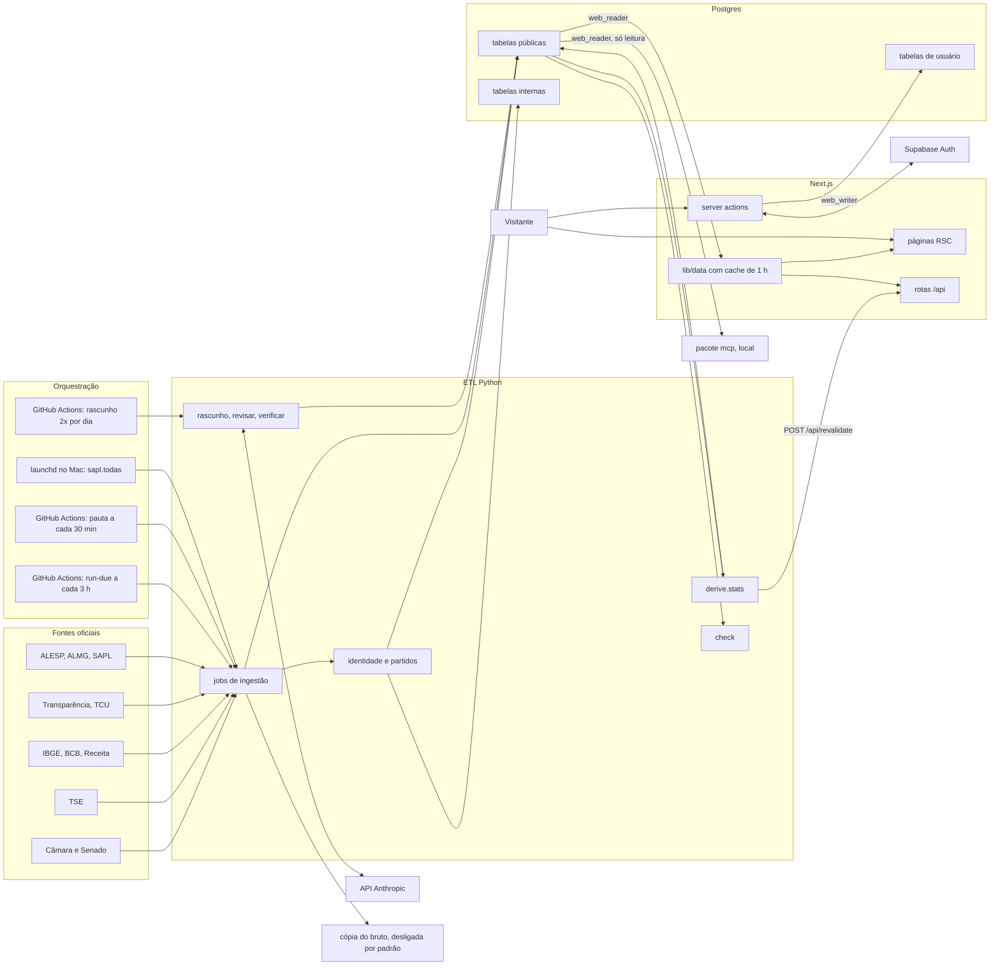
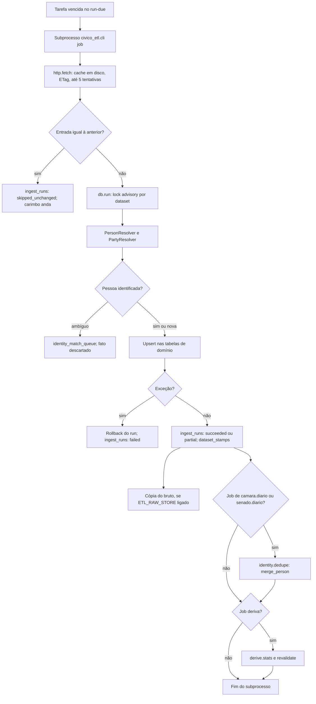
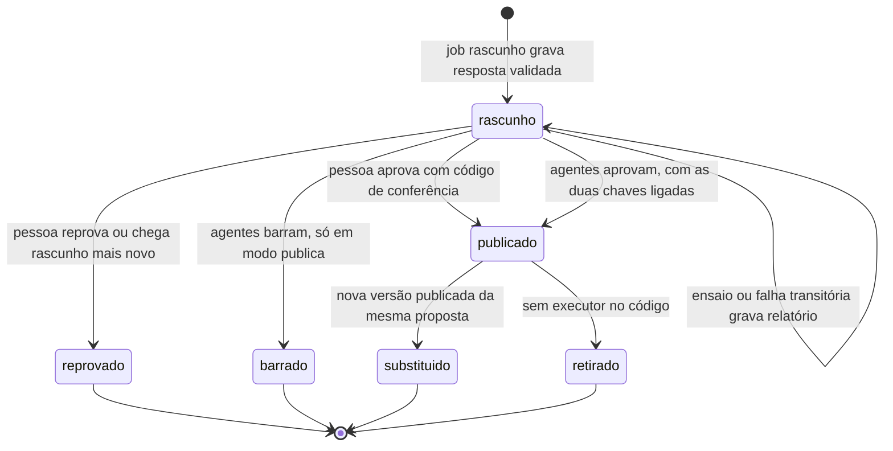
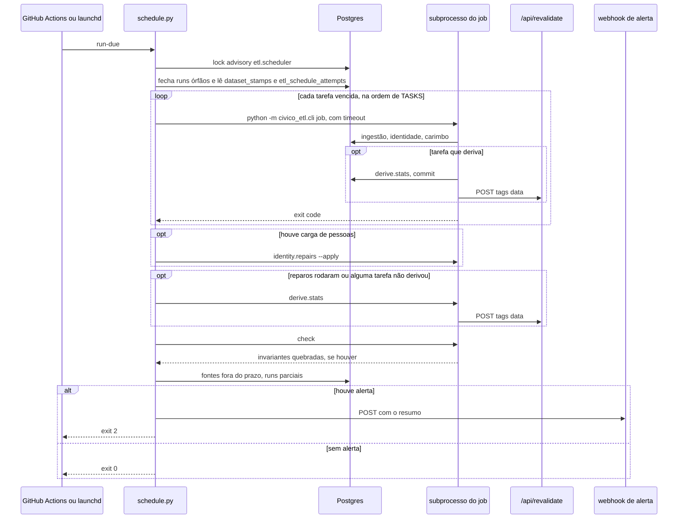
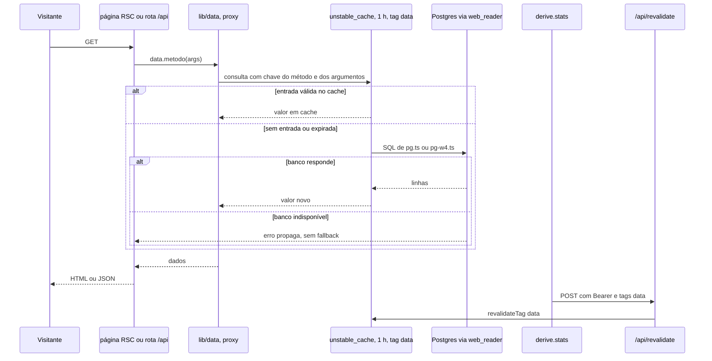
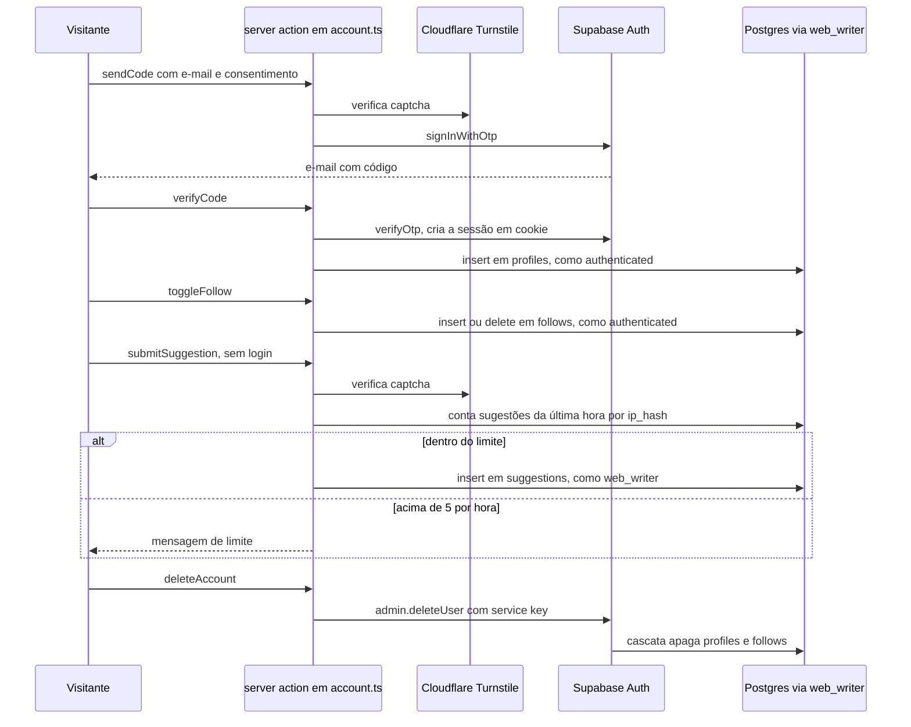

# Fluxo de dados: do dado oficial à tela

Mapa ponta a ponta de como o dado entra, é transformado, guardado, lido e exposto neste repositório, derivado do código. Onde este documento contradiz `replica/architecture.md`, `replica/integration.md` ou `replica/backend.md`, vale o código; as contradições estão na seção 9.

## 1. Premissas e método

- **Commit analisado:** `98645f3`, branch `claude/replica-data-flow-addb49`.
- **Método:** análise estática. Sete inventários independentes (ingestão, identidade e derivados, fluxo de IA, orquestração, banco, leitura, escrita do usuário), cruzados por tabela com uma varredura automática de quem escreve e quem lê cada relação.
- **Fora do alcance:** nada foi executado e nenhum banco foi consultado. Estado de produção (migrações aplicadas, secrets, variáveis do GitHub, agente launchd instalado, linha em `pipeline_switches`) aparece como `[exige execução]`. Arquivos `.env*` não foram lidos; nomes de variáveis vêm do código.
- **Marcações:** `[não verificado]` = não foi possível provar pelo código; `[exige execução]` = só rodando o sistema se confirma.
- **Mermaid:** sintaxe validada por renderização de cada diagrama, além da checagem estrutural do script.
- **Conferência:** `python3 -I replica/tools/fluxo_confere.py` verifica cobertura, caminhos citados, diagramas e seções.
- **Verificação independente:** duas amostras de 25 afirmações cada, por verificadores que não viram o inventário. Primeira (todas as seções): 14 confirmadas, 10 imprecisas, 1 falsa, mais 5 fluxos que faltavam. Segunda (modos de falha e células genéricas de idempotência da matriz): 15 confirmadas, 10 imprecisas, nenhuma falsa. Todos os 21 apontamentos e os 5 fluxos foram corrigidos; a reconferência dos itens da primeira amostra deu 25 de 25, e as correções da segunda não foram reconferidas.
- **Limite conhecido:** cerca de 40% das afirmações amostradas tinham algum detalhe impreciso antes da correção, quase sempre generalização de um job para o grupo. As células de idempotência e falha da seção 4 que não caíram em amostra devem ter taxa parecida: confira o job antes de depender de uma delas.

| Contagem derivada do código | Valor |
| --- | --- |
| Migrações em `db/migrations/` | 37 arquivos (há dois com prefixo 0131) |
| Tabelas vivas ao fim das migrações | 92 |
| Views | 5 |
| Jobs em `etl/civico_etl/jobs/` | 37 arquivos |
| Workflows em `.github/workflows/` | 5 |
| Scripts em `etl/deploy/` e `etl/agenda/` | 13 |
| Módulos em `web/src/lib/data/` | 10 |
| Route handlers em `web/src/app/` | 9 |
| Arquivos com a diretiva "use server" | 1 |
| Tools do MCP | 6 |
| Tarefas da agenda `run-due` | 23 |

## 2. Diagrama de contexto

## 3. Diagramas por fluxo

### 3.1 Ingestão recorrente

### 3.2 Fluxo de IA: estados de `answer_drafts`

### 3.3 Ciclo agendado `run-due`

### 3.4 Leitura e invalidação de cache

### 3.5 Escrita do usuário

## 4. Matriz de linhagem

Uma linha por tabela ou view viva ao fim das migrações. "Role de escrita do ETL" é a conexão de `ETL_DATABASE_URL`: nenhuma migração cria role próprio para o ETL nem concede escrita a `service_role`, então presume-se o dono do banco (ver 9.6). A coluna de evidência traz a migração de origem, o primeiro ponto de escrita e o primeiro ponto de leitura encontrados.

| tabela | escrita por | fonte de origem | gatilho e cadência | idempotência | comportamento em falha | lida por | role | evidência |
| --- | --- | --- | --- | --- | --- | --- | --- | --- |
| `activity_events` | nenhum | — | — | sem escritor no repo | — | ninguém | escrita: —; leitura: `web_reader` | `db/migrations/0001_init.sql:761` |
| `agenda_events` | `agenda_congresso.py` | Câmara e Senado (agenda de plenário) | run-due, 20 h | upsert `(house, source_key)` | pauta que falha mantém itens antigos; exceção = rollback do run; runs anteriores ficam | web (`pg.ts`) | escrita: ETL: dono do banco [não verificado]; leitura: `web_reader` | `db/migrations/0031_agenda.sql:5` `etl/civico_etl/jobs/agenda_congresso.py:163` `web/src/lib/data/pg.ts:1144` |
| `agenda_items` | `agenda_congresso.py` | Câmara e Senado (agenda de plenário) | run-due, 20 h | upsert `(agenda_event_id, position)`; apaga ausentes só de evento relido | exceção = rollback do run; runs anteriores ficam | web (`pg.ts`) | escrita: ETL: dono do banco [não verificado]; leitura: `web_reader` | `db/migrations/0031_agenda.sql:25` `etl/civico_etl/jobs/agenda_congresso.py:190` `web/src/lib/data/pg.ts:1154` |
| `amendments` | `transparencia_emendas.py` | Portal da Transparência (emendas) | run-due, 7 d | upsert por `source_key`, sem delete | leitura antes do run; páginas deslocadas descartam o ano | web (`pg.ts`) | escrita: ETL: dono do banco [não verificado]; leitura: `web_reader` | `db/migrations/0001_init.sql:673` `etl/civico_etl/jobs/transparencia_emendas.py:243` `web/src/lib/data/pg.ts:207` |
| `answer_drafts` | `rascunho.py`; `revisar.py`; `verificar.py` | PDF de inteiro teor da Câmara + API Anthropic; decisão de pessoa; PDF + agentes verificadores | `etl-rascunho.yml`, 08:30 e 14:30 BRT; manual (CLI); manual (CLI); sem agendamento | pula PDF já visto (sha256 + versão do prompt) se há rascunho, publicado ou barrado na versão atual do verificador; reprovado é redigido de novo; transições guardadas por trigger | recusa ou PDF sem texto vira nota; nada é gravado | web (`pg.ts`) | escrita: ETL: dono do banco [não verificado]; leitura: `web_reader`, 15 colunas e só linhas públicas | `db/migrations/0080_answer_drafts.sql:5` `etl/civico_etl/jobs/rascunho.py:118` `etl/civico_etl/jobs/revisar.py:78` `etl/civico_etl/jobs/verificar.py:329` `web/src/lib/data/pg.ts:1380` `db/migrations/0130_verificacao_agentica.sql:45-73` `etl/civico_etl/jobs/rascunho.py:100-112` |
| `asset_declarations` | `tse_candidatos.py`; reparos pontuais (manuais) | TSE (consulta_cand, bem_candidato) | run-due, 7 d (eleição atual e anterior) | upsert por `candidacy_id`; apaga a declaração de registro substituído, com trilha | exceção = rollback do run; runs anteriores ficam | web (`pg.ts`); MCP | escrita: ETL: dono do banco [não verificado]; leitura: `web_reader` | `db/migrations/0001_init.sql:310` `etl/civico_etl/jobs/tse_candidatos.py:475` `etl/civico_etl/jobs/identity_bug038.py:262` `etl/civico_etl/jobs/identity_bug041.py:151` `web/src/lib/data/pg.ts:602` `mcp/src/tools.ts:211` `etl/civico_etl/jobs/tse_candidatos.py:516-520` |
| `asset_items` | nenhum | — | — | sem escritor no repo | — | ninguém | escrita: —; leitura: `web_reader` | `db/migrations/0001_init.sql:322` |
| `attendance` | `camara_presenca.py`; `senado_extras.py`; reparos pontuais (manuais) | Câmara (CSVs de eventos e presença); Senado dados abertos e CEAPS | run-due, 20 h; dentro de `senado.diario` | Câmara: delete do ano + upsert `(session_id, person_id)`; Senado: delete de toda a presença derivada de voto, sem upsert | Câmara: run por ano, exceção = rollback do run; runs anteriores ficam; Senado: fora de run, commit próprio | web (`pg.ts`) | escrita: ETL: dono do banco [não verificado]; leitura: `web_reader` | `db/migrations/0001_init.sql:527` `etl/civico_etl/jobs/camara_presenca.py:154` `etl/civico_etl/jobs/senado_extras.py:33` `etl/civico_etl/jobs/identity_bug033.py:313` `web/src/lib/data/pg.ts:694` `etl/civico_etl/jobs/senado_extras.py:32-35` |
| `bloc_members` | nenhum | — | — | sem escritor no repo | — | ninguém | escrita: —; leitura: `web_reader` | `db/migrations/0001_init.sql:571` |
| `campaign_finance_by_origin` | `tse_votos_contas.py` | TSE (votação por município, prestação de contas) | run-due, 30 d | upsert + prune por ano | run por ano; exceção = rollback do run; runs anteriores ficam | web (`pg.ts`) | escrita: ETL: dono do banco [não verificado]; leitura: `web_reader` | `db/migrations/0084_campaign_finance_by_origin.sql:5` `etl/civico_etl/jobs/tse_votos_contas.py:323` `web/src/lib/data/pg.ts:801` |
| `campaign_finance_donors` | `tse_votos_contas.py` | TSE (votação por município, prestação de contas) | run-due, 30 d | upsert + prune por ano | run por ano; exceção = rollback do run; runs anteriores ficam | web (`pg.ts`) | escrita: ETL: dono do banco [não verificado]; leitura: `web_reader` | `db/migrations/0084_campaign_finance_by_origin.sql:17` `etl/civico_etl/jobs/tse_votos_contas.py:324` `web/src/lib/data/pg.ts:804` |
| `campaign_finance_entries` | `tse_votos_contas.py`; reparos pontuais (manuais) | TSE (votação por município, prestação de contas) | run-due, 30 d | upsert por `source_key`, sem delete: categoria que some da fonte fica | run por ano; exceção = rollback do run; runs anteriores ficam | web (`pg.ts`) | escrita: ETL: dono do banco [não verificado]; leitura: `web_reader` | `db/migrations/0001_init.sql:294` `etl/civico_etl/jobs/tse_votos_contas.py:295` `etl/civico_etl/jobs/tse_bug019.py:151` `web/src/lib/data/pg.ts:773` `etl/civico_etl/jobs/tse_votos_contas.py:290-296` |
| `candidacies` | `tse_candidatos.py`; `tse_votos_contas.py`; reparos pontuais (manuais) | TSE (consulta_cand, bem_candidato); TSE (votação por município, prestação de contas) | run-due, 7 d (eleição atual e anterior); run-due, 30 d | upsert por chave natural | fetch antes do run; exceção = rollback do run; runs anteriores ficam | web (`pg-w4.ts`, `pg.ts`); MCP | escrita: ETL: dono do banco [não verificado]; leitura: `web_reader` | `db/migrations/0001_init.sql:258` `etl/civico_etl/jobs/tse_candidatos.py:522` `etl/civico_etl/jobs/tse_votos_contas.py:48` `etl/civico_etl/jobs/identity_bug038.py:254` `web/src/lib/data/pg-w4.ts:47` `mcp/src/tools.ts:212` |
| `candidacy_place_votes` | `tse_votos_contas.py`; reparos pontuais (manuais) | TSE (votação por município, prestação de contas) | run-due, 30 d | upsert por chave natural | run por ano; exceção = rollback do run; runs anteriores ficam | web (`pg.ts`) | escrita: ETL: dono do banco [não verificado]; leitura: `web_reader` | `db/migrations/0001_init.sql:283` `etl/civico_etl/jobs/tse_votos_contas.py:98` `etl/civico_etl/jobs/tse_bug019.py:143` `web/src/lib/data/pg.ts:463` |
| `committee_memberships` | `parlamento_extras.py` | Câmara e Senado (contatos, comissões, discursos) | run-due, 7 d | upsert por chave natural | run único; erro diferente de 404 aborta tudo | web (`pg.ts`) | escrita: ETL: dono do banco [não verificado]; leitura: `web_reader` | `db/migrations/0001_init.sql:638` `etl/civico_etl/jobs/parlamento_extras.py:131` `web/src/lib/data/pg.ts:1237` |
| `committees` | `parlamento_extras.py` | Câmara e Senado (contatos, comissões, discursos) | run-due, 7 d | upsert por chave natural | run único; erro diferente de 404 aborta tudo | web (`pg.ts`) | escrita: ETL: dono do banco [não verificado]; leitura: `web_reader` | `db/migrations/0001_init.sql:627` `etl/civico_etl/jobs/parlamento_extras.py:128` `web/src/lib/data/pg.ts:1237` |
| `contests` | `tse_candidatos.py` | TSE (consulta_cand, bem_candidato) | run-due, 7 d (eleição atual e anterior) | upsert por chave natural | exceção = rollback do run; runs anteriores ficam | web (`pg-w4.ts`, `pg.ts`); MCP | escrita: ETL: dono do banco [não verificado]; leitura: `web_reader` | `db/migrations/0001_init.sql:244` `etl/civico_etl/jobs/tse_candidatos.py:291` `web/src/lib/data/pg-w4.ts:45` `mcp/src/tools.ts:212` |
| `corporate_card_expenses` | nenhum | — | — | sem escritor no repo | — | ninguém | escrita: —; leitura: `web_reader` | `db/migrations/0001_init.sql:833` |
| `corrections` | nenhum | — | — | sem escritor no repo | — | ninguém | escrita: —; leitura: `web_reader` | `db/migrations/0001_init.sql:955` |
| `data_coverage` | `derive_stats.py`; `assembleias.py` (via `alesp.py`, `almg.py`); `sapl.py` | tabelas do próprio banco; ALESP e ALMG; SAPL (Interlegis e casas) | após tarefas que derivam e no fim do run-due; run-due, 6 d (`ale.todas`); `sapl.ales` no Actions, 20 h; `sapl.todas` no launchd do Mac, 20 h | derive: insert `on conflict do nothing`; ALE e SAPL: update pontual | derive em transação única | web (`pg.ts`); MCP | escrita: ETL: dono do banco [não verificado]; leitura: `web_reader` | `db/migrations/0001_init.sql:744` `etl/civico_etl/jobs/assembleias.py:338` `etl/civico_etl/jobs/derive_stats.py:458` `etl/civico_etl/jobs/sapl.py:422` `web/src/lib/data/pg.ts:350` `mcp/src/tools.ts:175` |
| `dataset_stamps` | `etl/civico_etl/db.py`; `governos_indicadores.py` | metadados do run; IBGE SIDRA e BCB SGS | todo run de ingestão, e também pauta, rascunho e verificar; run-due, 80 d | upsert por dataset em sucesso, `partial` e `skipped_unchanged`; pauta, rascunho e verificar também carimbam as fontes camara e senado | falha não carimba | web (`pg.ts`); MCP | escrita: ETL: dono do banco [não verificado]; leitura: `web_reader` | `db/migrations/0001_init.sql:66` `etl/civico_etl/db.py:212` `etl/civico_etl/jobs/governos_indicadores.py:97` `web/src/lib/data/pg.ts:383` `mcp/src/tools.ts:36` `etl/civico_etl/db.py:208-216` `etl/civico_etl/jobs/rascunho.py:380` `etl/civico_etl/jobs/pauta.py:132` |
| `digest_deliveries` | nenhum | — | — | sem escritor no repo | — | ninguém | escrita: `web_writer` (grant sem uso); leitura: sem grant a `web_reader` | `db/migrations/0001_init.sql:924` |
| `elections` | `tse_candidatos.py` | TSE (consulta_cand, bem_candidato) | run-due, 7 d (eleição atual e anterior) | upsert por chave natural | exceção = rollback do run; runs anteriores ficam | web (`pg-w4.ts`, `pg.ts`); MCP | escrita: ETL: dono do banco [não verificado]; leitura: `web_reader` | `db/migrations/0001_init.sql:233` `etl/civico_etl/jobs/tse_candidatos.py:285` `web/src/lib/data/pg-w4.ts:37` `mcp/src/tools.ts:212` |
| `etl_schedule_attempts` | `etl/civico_etl/schedule.py` | agenda | cada `run-due` | uma linha por tarefa | — | ETL (agenda) | escrita: ETL: dono do banco [não verificado]; leitura: sem grant a `web_reader` | `db/migrations/0075_etl_schedule.sql:3` `etl/civico_etl/schedule.py:380` |
| `expenses` | `camara_diario.py`; `senado_extras.py`; `assembleias.py` (via `alesp.py`, `almg.py`) | Câmara dados abertos (API v2, CSVs, cota); Senado dados abertos e CEAPS; ALESP e ALMG | run-due, 20 h; noturna 05:00–07:00 BRT; dentro de `senado.diario`; run-due, 6 d (`ale.todas`) | Câmara: upsert `(body_id, source_key)` + delete das chaves ausentes do ano; ALE: delete do ano + upsert; Senado (CEAPS): só upsert | arquivo vazio ou truncado da Câmara ou das ALE apaga o ano (prune sem trava) | web (`pg.ts`); MCP | escrita: ETL: dono do banco [não verificado]; leitura: `web_reader` | `db/migrations/0001_init.sql:654` `etl/civico_etl/jobs/assembleias.py:429` `etl/civico_etl/jobs/camara_diario.py:670` `etl/civico_etl/jobs/senado_extras.py:122` `web/src/lib/data/pg.ts:935` `mcp/src/tools.ts:416` `etl/civico_etl/jobs/camara_diario.py:666-678` `etl/civico_etl/jobs/assembleias.py:424-433` |
| `follows` | server action toggleFollow (`web/src/lib/account.ts`); ETL reaponta `person_id` via `merge_person` | usuário | ação do usuário | insert `on conflict do nothing` / delete; trigger limita a 200 | erro capturado, mensagem ao usuário | web (`account.ts`, `follows.ts`) | escrita: `web_writer` → `authenticated` (policies `own_follows_*`); leitura: sem grant a `web_reader` | `db/migrations/0001_init.sql:914` `web/src/lib/account.ts:68` `web/src/lib/account.ts:80` `db/migrations/0001_init.sql:1051-1059` `db/migrations/0002_merge_person.sql:43-59` |
| `gov_plan_excerpts` | nenhum | — | — | sem escritor no repo | — | ninguém | escrita: —; leitura: `web_reader` | `db/migrations/0001_init.sql:335` |
| `government_terms` | nenhum | — | — | sem escritor no repo | — | ninguém | escrita: —; leitura: `web_reader` | `db/migrations/0001_init.sql:796` |
| `identity_match_queue` | `etl/civico_etl/identity.py`; `assembleias.py` (via `alesp.py`, `almg.py`) | linha da fonte em carga; ALESP e ALMG | dentro de `tse.candidatos`, `camara.diario`, `senado.diario`; run-due, 6 d (`ale.todas`) | upsert `(source_id, external_id)`; só atualiza se `pendente` | fato ambíguo é rejeitado e relido na carga seguinte | ninguém | escrita: ETL: dono do banco [não verificado]; leitura: sem grant a `web_reader` | `db/migrations/0001_init.sql:776` `etl/civico_etl/identity.py:445-458` `etl/civico_etl/jobs/assembleias.py:285-294` |
| `identity_repair_log` | `tse_candidatos.py`; reparos pontuais (manuais) | TSE (consulta_cand, bem_candidato) | run-due, 7 d (eleição atual e anterior) | insert de trilha | — | ETL (`checks_identity.py`) | escrita: ETL: dono do banco [não verificado]; leitura: sem grant a `web_reader` | `db/migrations/0058_identity_repair_log.sql:7` `etl/civico_etl/jobs/tse_candidatos.py:516` `etl/civico_etl/jobs/tse_bug032.py:249` `etl/civico_etl/jobs/tse_bug035.py:179` |
| `identity_split_log` | `repairs.py`; reparos pontuais (manuais) | consulta_cand em cache | fim do run-due, após carga de pessoas | insert `on conflict do nothing` | — | ETL (`identity_bug033.py`, devolução manual) | escrita: ETL: dono do banco [não verificado]; leitura: sem grant a `web_reader` | `db/migrations/0060_identity_split_log.sql:4` `etl/civico_etl/jobs/repairs.py:164` `etl/civico_etl/jobs/identity_bug033.py:197` `etl/civico_etl/jobs/identity_bug038.py:168` `etl/civico_etl/jobs/identity_bug033.py:374` |
| `ingest_runs` | `etl/civico_etl/db.py`; `sapl.py`; `etl/civico_etl/schedule.py`; `etl/civico_etl/rawstore.py` | metadados do run; SAPL (Interlegis e casas); agenda; cópia do bruto | todo run de ingestão, e também pauta, rascunho e verificar; `sapl.ales` no Actions, 20 h; `sapl.todas` no launchd do Mac, 20 h; cada `run-due`; ao fechar run com a cópia ligada, e no `purge-raw` | uma linha por run; lock advisory por dataset | fecha `failed` com traceback; órfãos fechados pelo run-due | ETL (agenda e derive) | escrita: ETL: dono do banco [não verificado]; leitura: sem grant a `web_reader` | `db/migrations/0001_init.sql:48` `etl/civico_etl/db.py:115` `etl/civico_etl/jobs/sapl.py:424` `etl/civico_etl/rawstore.py:205` `etl/civico_etl/db.py:134-205` |
| `laws` | `camara_diario.py` | Câmara dados abertos (API v2, CSVs, cota) | run-due, 20 h; noturna 05:00–07:00 BRT | upsert por chave natural | exceção = rollback do run; runs anteriores ficam | web (`pg.ts`) | escrita: ETL: dono do banco [não verificado]; leitura: `web_reader` | `db/migrations/0001_init.sql:442` `etl/civico_etl/jobs/camara_diario.py:496` `web/src/lib/data/pg.ts:1136` |
| `legislative_bodies` | `ibge_places.py`; `assembleias.py` (via `alesp.py`, `almg.py`); `sapl.py` | IBGE localidades; ALESP e ALMG; SAPL (Interlegis e casas) | run-due, 365 d; run-due, 6 d (`ale.todas`); `sapl.ales` no Actions, 20 h; `sapl.todas` no launchd do Mac, 20 h | upsert `(kind, place_id)` | exceção = rollback do run; runs anteriores ficam | web (`pg-w4.ts`, `pg.ts`); MCP | escrita: ETL: dono do banco [não verificado]; leitura: `web_reader` | `db/migrations/0001_init.sql:145` `etl/civico_etl/jobs/assembleias.py:329` `etl/civico_etl/jobs/ibge_places.py:71` `etl/civico_etl/jobs/sapl.py:675` `web/src/lib/data/pg-w4.ts:154` `mcp/src/tools.ts:325` |
| `live_count_snapshots` | nenhum | — | — | sem escritor no repo | — | ninguém | escrita: —; leitura: `web_reader` | `db/migrations/0001_init.sql:349` |
| `mandate_contacts` | `parlamento_extras.py` | Câmara e Senado (contatos, comissões, discursos) | run-due, 7 d | apaga os contatos dos mandatos que trouxeram contato nesta leitura e insere com `on conflict do nothing`; mandato sem contato hoje mantém os antigos | run único; erro diferente de 404 aborta tudo | web (`pg.ts`) | escrita: ETL: dono do banco [não verificado]; leitura: `web_reader` | `db/migrations/0001_init.sql:411` `etl/civico_etl/jobs/parlamento_extras.py:125` `web/src/lib/data/pg.ts:1252` |
| `mandate_periods` | nenhum | — | — | sem escritor no repo | — | ninguém | escrita: —; leitura: `web_reader` | `db/migrations/0001_init.sql:394` |
| `mandates` | `tse_candidatos.py`; `tse_votos_contas.py`; `camara_diario.py`; `senado_diario.py`; `derive_stats.py`; `repairs.py`; reparos pontuais (manuais) | TSE (consulta_cand, bem_candidato); TSE (votação por município, prestação de contas); Câmara dados abertos (API v2, CSVs, cota); Senado dados abertos (JSON); tabelas do próprio banco; consulta_cand em cache | run-due, 7 d (eleição atual e anterior); run-due, 30 d; run-due, 20 h; noturna 05:00–07:00 BRT; run-due, 20 h; noturna 00:30–02:00 BRT; após tarefas que derivam e no fim do run-due; fim do run-due, após carga de pessoas | upsert; regras de vacância com guarda de estado | exceção = rollback do run; runs anteriores ficam | web (`pg-w4.ts`, `pg.ts`); MCP | escrita: ETL: dono do banco [não verificado]; leitura: `web_reader` | `db/migrations/0001_init.sql:363` `etl/civico_etl/jobs/camara_diario.py:274` `etl/civico_etl/jobs/derive_stats.py:231` `etl/civico_etl/jobs/repairs.py:169` `web/src/lib/data/pg-w4.ts:147` `mcp/src/tools.ts:79` `etl/civico_etl/jobs/derive_stats.py:228-291` |
| `offices` | `seed.py`; migração (seed em SQL) | constantes do código; SQL versionado | manual, CI e após `ibge.populacao`; ao aplicar migrações | upsert por slug | commit único | web (`pg-w4.ts`, `pg.ts`); MCP | escrita: ETL: dono do banco [não verificado]; leitura: `web_reader` | `db/migrations/0001_init.sql:133` `etl/civico_etl/jobs/seed.py:139` `web/src/lib/data/pg-w4.ts:46` `mcp/src/tools.ts:81` |
| `orientation_actors` | `camara_diario.py` | Câmara dados abertos (API v2, CSVs, cota) | run-due, 20 h; noturna 05:00–07:00 BRT | upsert por chave natural | exceção = rollback do run; runs anteriores ficam | web (`pg-w4.ts`, `pg.ts`) | escrita: ETL: dono do banco [não verificado]; leitura: `web_reader` | `db/migrations/0001_init.sql:558` `etl/civico_etl/jobs/camara_diario.py:414` `web/src/lib/data/pg-w4.ts:161` |
| `page_view_hourly` | nenhum | — | — | sem escritor no repo | — | ninguém | escrita: —; leitura: `web_reader` | `db/migrations/0001_init.sql:993` |
| `page_views` | nenhum | — | — | sem escritor no repo | — | ninguém | escrita: —; leitura: sem grant a `web_reader` | `db/migrations/0001_init.sql:977` |
| `parties` | `etl/civico_etl/parties.py` | sigla e número do partido na fonte | dentro das cargas de pessoas | insert `on conflict (acronym, valid_from)` | sigla desconhecida cria partido novo | web (`pg-w4.ts`, `pg.ts`); MCP | escrita: ETL: dono do banco [não verificado]; leitura: `web_reader` | `db/migrations/0001_init.sql:98` `etl/civico_etl/parties.py:60` `web/src/lib/data/pg-w4.ts:69` `mcp/src/tools.ts:84` |
| `party_aliases` | `etl/civico_etl/parties.py` | sigla e número do partido na fonte | dentro das cargas de pessoas | insert se o alias não existe | — | ETL (`etl/civico_etl/parties.py`) | escrita: ETL: dono do banco [não verificado]; leitura: `web_reader` | `db/migrations/0001_init.sql:120` `etl/civico_etl/parties.py:77` |
| `party_memberships` | `derive_stats.py` | tabelas do próprio banco | após tarefas que derivam e no fim do run-due | diff: apaga o que sumiu e insere o novo | transação única do derive | view `person_current_party` | escrita: ETL: dono do banco [não verificado]; leitura: `web_reader` | `db/migrations/0001_init.sql:215` `etl/civico_etl/jobs/derive_stats.py:496` `etl/civico_etl/jobs/derive_stats.py:493-502` |
| `party_observations` | `camara_diario.py`; `camara_presenca.py`; `senado_extras.py` | Câmara dados abertos (API v2, CSVs, cota); Câmara (CSVs de eventos e presença); Senado dados abertos e CEAPS | run-due, 20 h; noturna 05:00–07:00 BRT; run-due, 20 h; dentro de `senado.diario` | upsert por chave natural | em `camara_presenca.py` grava fora do run, com commit próprio | ETL (`derive_stats.py`) | escrita: ETL: dono do banco [não verificado]; leitura: sem grant a `web_reader` | `db/migrations/0010_party_observations.sql:5` `etl/civico_etl/jobs/camara_diario.py:269` `etl/civico_etl/jobs/camara_presenca.py:170` `etl/civico_etl/jobs/senado_extras.py:57` `etl/civico_etl/jobs/camara_presenca.py:168-171` |
| `party_orientations` | `camara_diario.py` | Câmara dados abertos (API v2, CSVs, cota) | run-due, 20 h; noturna 05:00–07:00 BRT | upsert por chave natural | exceção = rollback do run; runs anteriores ficam | web (`pg-w4.ts`, `pg.ts`) | escrita: ETL: dono do banco [não verificado]; leitura: `web_reader` | `db/migrations/0001_init.sql:580` `etl/civico_etl/jobs/camara_diario.py:419` `web/src/lib/data/pg-w4.ts:161` |
| `pauta_bolso` | view sobre `pauta_current` filtrada pela regra do bolso | derivada | calculada na leitura | view (`security_invoker`) | — | web (`pg.ts`) | escrita: —; leitura: `web_reader` | `db/migrations/0076_pauta.sql:85` `web/src/lib/data/pg.ts:1357` `db/migrations/0076_pauta.sql:85-88` |
| `pauta_current` | view sobre `pauta_items` da última `pauta_reads` por casa | derivada | calculada na leitura | view (`security_invoker`) | — | web (`pg.ts`) | escrita: —; leitura: `web_reader` | `db/migrations/0076_pauta.sql:67` `web/src/lib/data/pg.ts:1426` `db/migrations/0076_pauta.sql:67-82` |
| `pauta_events` | `pauta.py` | Câmara e Senado (eventos e pauta) | `etl-pauta.yml`, a cada 30 min em dia útil | append-only por leitura | evento que falha entra em `failed_refs` | view `pauta_exits` | escrita: ETL: dono do banco [não verificado]; leitura: `web_reader` | `db/migrations/0078_pauta_saida.sql:7` `etl/civico_etl/jobs/pauta.py:119` `etl/civico_etl/jobs/pauta.py:91-128` |
| `pauta_exits` | view sobre `pauta_reads` + `pauta_items` + `pauta_events` | derivada | calculada na leitura | view (`security_invoker`) | — | web (`pg.ts`) | escrita: —; leitura: `web_reader` | `db/migrations/0078_pauta_saida.sql:32` `web/src/lib/data/pg.ts:1368` `db/migrations/0078_pauta_saida.sql:32-74` |
| `pauta_items` | `pauta.py` | Câmara e Senado (eventos e pauta) | `etl-pauta.yml`, a cada 30 min em dia útil | append-only por leitura | evento que falha entra em `failed_refs` | web (`pg.ts`) | escrita: ETL: dono do banco [não verificado]; leitura: `web_reader` | `db/migrations/0076_pauta.sql:42` `etl/civico_etl/jobs/pauta.py:113` `web/src/lib/data/pg.ts:1365` `etl/civico_etl/jobs/pauta.py:91-128` |
| `pauta_reads` | `pauta.py` | Câmara e Senado (eventos e pauta) | `etl-pauta.yml`, a cada 30 min em dia útil | append-only: cada run cria uma leitura nova | falha em `pauta.camara` impede `pauta.senado` | web (`pg.ts`) | escrita: ETL: dono do banco [não verificado]; leitura: `web_reader` | `db/migrations/0076_pauta.sql:26` `etl/civico_etl/jobs/pauta.py:96` `web/src/lib/data/pg.ts:1360` |
| `people` | `etl/civico_etl/identity.py`; `camara_diario.py`; `senado_diario.py`; `identity_dedupe.py`; reparos pontuais (manuais) | linha da fonte em carga; Câmara dados abertos (API v2, CSVs, cota); Senado dados abertos (JSON); tabelas do próprio banco | dentro de `tse.candidatos`, `camara.diario`, `senado.diario`; run-due, 20 h; noturna 05:00–07:00 BRT; run-due, 20 h; noturna 00:30–02:00 BRT; após `camara.diario` e `senado.diario` | insert sem `on conflict`; reexecução casa pelo id externo; as cargas da Câmara e do Senado atualizam nome e foto | morte antes do flush perde a transação | web (`follows.ts`, `pg-w4.ts`, `pg.ts`); MCP | escrita: ETL: dono do banco [não verificado]; leitura: `web_reader` | `db/migrations/0001_init.sql:172` `etl/civico_etl/identity.py:408` `etl/civico_etl/jobs/camara_diario.py:149` `etl/civico_etl/jobs/senado_diario.py:137` `web/src/lib/data/pg-w4.ts:69` `mcp/src/tools.ts:80` `etl/civico_etl/identity.py:389-428` |
| `person_current_party` | view sobre `party_memberships` vigentes hoje | derivada | calculada na leitura | view (`security_invoker`) | — | web (`pg-w4.ts`, `pg.ts`); MCP | escrita: —; leitura: `web_reader` | `db/migrations/0001_init.sql:1066` `web/src/lib/data/pg-w4.ts:149` `mcp/src/tools.ts:83` `db/migrations/0001_init.sql:1066-1070` |
| `person_external_ids` | `etl/civico_etl/identity.py`; `assembleias.py` (via `alesp.py`, `almg.py`); reparos pontuais (manuais) | linha da fonte em carga; ALESP e ALMG | dentro de `tse.candidatos`, `camara.diario`, `senado.diario`; run-due, 6 d (`ale.todas`) | upsert `(source_id, external_id)` sem update | — | ETL (resolver de identidade) | escrita: ETL: dono do banco [não verificado]; leitura: sem grant a `web_reader` | `db/migrations/0001_init.sql:202` `etl/civico_etl/jobs/identity_bug038.py:268` `etl/civico_etl/jobs/identity_bug041.py:157` `etl/civico_etl/jobs/tse_bug032.py:340` `etl/civico_etl/identity.py:430-459` `etl/civico_etl/jobs/assembleias.py:286-288` |
| `person_period_stats` | `derive_stats.py` | tabelas do próprio banco | após tarefas que derivam e no fim do run-due | upsert `(person_id, period)` com `is distinct from`; nunca apaga | transação única do derive | web (`pg.ts`); MCP | escrita: ETL: dono do banco [não verificado]; leitura: `web_reader` | `db/migrations/0001_init.sql:724` `etl/civico_etl/jobs/derive_stats.py:148` `web/src/lib/data/pg.ts:621` `mcp/src/tools.ts:171` `etl/civico_etl/jobs/derive_stats.py:169-185` |
| `person_slug_redirects` | `identity_dedupe.py` | tabelas do próprio banco | após `camara.diario` e `senado.diario` | função SQL `merge_person`, `on conflict do update` | exceção aborta o lote de fusões | web (`pg.ts`); MCP | escrita: ETL: dono do banco [não verificado]; leitura: `web_reader` | `db/migrations/0001_init.sql:193` `web/src/lib/data/pg.ts:563` `mcp/src/tools.ts:112` `db/migrations/0002_merge_person.sql:10-76` |
| `pipeline_switches` | dono do banco, à mão | decisão do dono | manual | uma linha por chave | — | ETL (`verificar.py`) | escrita: dono do banco; leitura: sem grant a `web_reader` | `db/migrations/0130_verificacao_agentica.sql:76` |
| `places` | `ibge_places.py`; `ibge_populacao.py` | IBGE localidades; IBGE agregado 6579 | run-due, 365 d | upsert `(ibge_code)`; população só onde difere | exceção = rollback do run; runs anteriores ficam | web (`pg-w4.ts`, `pg.ts`); MCP | escrita: ETL: dono do banco [não verificado]; leitura: `web_reader` | `db/migrations/0001_init.sql:82` `etl/civico_etl/jobs/ibge_places.py:49` `etl/civico_etl/jobs/ibge_populacao.py:41` `web/src/lib/data/pg-w4.ts:59` `mcp/src/tools.ts:82` |
| `pocket_rules` | migração (seed em SQL) | SQL versionado | ao aplicar migrações | regra versionada (v1, v2) | — | web (`pg.ts`) | escrita: dono do banco; leitura: `web_reader` | `db/migrations/0076_pauta.sql:6` `web/src/lib/data/pg.ts:1362` `db/migrations/0076_pauta.sql:16` `db/migrations/0077_pocket_rule_v2.sql:4` |
| `pocket_week_count` | view sobre `pauta_bolso` + `pauta_reads` | derivada | calculada na leitura | view (`security_invoker`) | — | web (`pg.ts`) | escrita: —; leitura: `web_reader` | `db/migrations/0076_pauta.sql:91` `web/src/lib/data/pg.ts:1356` `db/migrations/0076_pauta.sql:91-103` |
| `profiles` | server action verifyCode, updateDigest (`web/src/lib/account.ts`) | usuário | ação do usuário | insert `on conflict do nothing`; update de `digest` | erro não capturado: 500 com a sessão já criada | web (`follows.ts`) | escrita: `web_writer` → `authenticated` (policies `own_profile_*`); leitura: sem grant a `web_reader` | `db/migrations/0001_init.sql:906` `web/src/lib/account.ts:54` `web/src/lib/follows.ts:12` `db/migrations/0001_init.sql:1046-1049` |
| `proposal_authors` | `camara_diario.py`; `senado_extras.py`; `assembleias.py` (via `alesp.py`, `almg.py`); reparos pontuais (manuais) | Câmara dados abertos (API v2, CSVs, cota); Senado dados abertos e CEAPS; ALESP e ALMG | run-due, 20 h; noturna 05:00–07:00 BRT; dentro de `senado.diario`; run-due, 6 d (`ale.todas`) | delete do ano + upsert (ALE); upsert (Câmara, Senado) | exceção = rollback do run; runs anteriores ficam | web (`pg.ts`) | escrita: ETL: dono do banco [não verificado]; leitura: `web_reader` | `db/migrations/0001_init.sql:477` `etl/civico_etl/jobs/assembleias.py:409` `etl/civico_etl/jobs/camara_diario.py:518` `etl/civico_etl/jobs/senado_extras.py:87` `web/src/lib/data/pg.ts:859` |
| `proposal_topics` | `camara_diario.py` | Câmara dados abertos (API v2, CSVs, cota) | run-due, 20 h; noturna 05:00–07:00 BRT | upsert por chave natural | exceção = rollback do run; runs anteriores ficam | web (`pg.ts`); MCP | escrita: ETL: dono do banco [não verificado]; leitura: `web_reader` | `db/migrations/0001_init.sql:488` `etl/civico_etl/jobs/camara_diario.py:534` `web/src/lib/data/pg.ts:857` `mcp/src/tools.ts:320` |
| `proposals` | `camara_diario.py`; `senado_diario.py`; `senado_extras.py`; `assembleias.py` (via `alesp.py`, `almg.py`) | Câmara dados abertos (API v2, CSVs, cota); Senado dados abertos (JSON); Senado dados abertos e CEAPS; ALESP e ALMG | run-due, 20 h; noturna 05:00–07:00 BRT; run-due, 20 h; noturna 00:30–02:00 BRT; dentro de `senado.diario`; run-due, 6 d (`ale.todas`) | upsert `(body_id, type, number, year)` | exceção = rollback do run; runs anteriores ficam | web (`pg.ts`); MCP | escrita: ETL: dono do banco [não verificado]; leitura: `web_reader` | `db/migrations/0001_init.sql:456` `etl/civico_etl/jobs/assembleias.py:404` `etl/civico_etl/jobs/camara_diario.py:331` `etl/civico_etl/jobs/senado_diario.py:279` `web/src/lib/data/pg.ts:859` `mcp/src/tools.ts:325` |
| `rascunho_batches` | `rascunho.py` | PDF de inteiro teor da Câmara + API Anthropic | `etl-rascunho.yml`, 08:30 e 14:30 BRT | uma linha por lote; estados enviado → coletado, cancelado ou expirado | lote vencido cai para o modo síncrono | ETL (`rascunho.py`) | escrita: ETL: dono do banco [não verificado]; leitura: sem grant a `web_reader` | `db/migrations/0090_rascunho_batch.sql:11` `etl/civico_etl/jobs/rascunho.py:140` `db/migrations/0090_rascunho_batch.sql:5-23` |
| `salaries` | `seed.py` | constantes do código | manual, CI e após `ibge.populacao` | upsert; apaga valores fora da norma | commit único | web (`pg.ts`); MCP | escrita: ETL: dono do banco [não verificado]; leitura: `web_reader` | `db/migrations/0001_init.sql:423` `etl/civico_etl/jobs/seed.py:99` `web/src/lib/data/pg.ts:625` `mcp/src/tools.ts:194` |
| `sanctions` | `sancoes.py` | TCU inabilitados; CGU CEIS/CNEP | run-due, 28 d (TCU) e 7 d (CGU) | upsert `(source, source_key)`; delete do que some da lista: CGU com travas (truncada, vazia, menor que a metade); TCU só exige lista não vazia | paginação inteira antes de gravar | ninguém na web nem no MCP (só `checks.py`) | escrita: ETL: dono do banco [não verificado]; leitura: `web_reader` | `db/migrations/0033_sanctions.sql:4` `etl/civico_etl/jobs/sancoes.py:131` |
| `sapl_autorias` | `sapl.py` | SAPL (Interlegis e casas) | `sapl.ales` no Actions, 20 h; `sapl.todas` no launchd do Mac, 20 h | upsert por chave natural | cada casa em conexão própria; backoff de 6 h a 7 dias | web (`pg.ts`) | escrita: ETL: dono do banco [não verificado]; leitura: `web_reader` | `db/migrations/0032_sapl.sql:65` `etl/civico_etl/jobs/sapl.py:513` `web/src/lib/data/pg.ts:422` |
| `sapl_cursors` | `sapl.py` | SAPL (Interlegis e casas) | `sapl.ales` no Actions, 20 h; `sapl.todas` no launchd do Mac, 20 h | cursor por casa e entidade | idem SAPL | ETL (`sapl.py`) | escrita: ETL: dono do banco [não verificado]; leitura: sem grant a `web_reader` | `db/migrations/0070_sapl_incremental.sql:3` `etl/civico_etl/jobs/sapl.py:398` |
| `sapl_houses` | `sapl.py` | SAPL (Interlegis e casas) | `sapl.ales` no Actions, 20 h; `sapl.todas` no launchd do Mac, 20 h | upsert por chave natural | idem SAPL | web (`pg.ts`) | escrita: ETL: dono do banco [não verificado]; leitura: `web_reader` | `db/migrations/0032_sapl.sql:4` `etl/civico_etl/jobs/sapl.py:362` `web/src/lib/data/pg.ts:363` |
| `sapl_mandatos` | `sapl.py` | SAPL (Interlegis e casas) | `sapl.ales` no Actions, 20 h; `sapl.todas` no launchd do Mac, 20 h | upsert por chave natural | idem SAPL | ETL (`repairs.py`) | escrita: ETL: dono do banco [não verificado]; leitura: `web_reader` | `db/migrations/0032_sapl.sql:37` `etl/civico_etl/jobs/sapl.py:454` |
| `sapl_materias` | `sapl.py` | SAPL (Interlegis e casas) | `sapl.ales` no Actions, 20 h; `sapl.todas` no launchd do Mac, 20 h | upsert por chave natural | idem SAPL | web (`pg.ts`) | escrita: ETL: dono do banco [não verificado]; leitura: `web_reader` | `db/migrations/0032_sapl.sql:49` `etl/civico_etl/jobs/sapl.py:486` `web/src/lib/data/pg.ts:422` |
| `sapl_parlamentares` | `sapl.py` | SAPL (Interlegis e casas) | `sapl.ales` no Actions, 20 h; `sapl.todas` no launchd do Mac, 20 h | upsert por chave natural | idem SAPL | web (`pg.ts`) | escrita: ETL: dono do banco [não verificado]; leitura: `web_reader` | `db/migrations/0032_sapl.sql:20` `etl/civico_etl/jobs/sapl.py:449` `web/src/lib/data/pg.ts:417` |
| `sapl_presencas` | `sapl.py` | SAPL (Interlegis e casas) | `sapl.ales` no Actions, 20 h; `sapl.todas` no launchd do Mac, 20 h | upsert por chave natural | idem SAPL | web (`pg.ts`) | escrita: ETL: dono do banco [não verificado]; leitura: `web_reader` | `db/migrations/0032_sapl.sql:91` `etl/civico_etl/jobs/sapl.py:543` `web/src/lib/data/pg.ts:428` |
| `sapl_sessoes` | `sapl.py` | SAPL (Interlegis e casas) | `sapl.ales` no Actions, 20 h; `sapl.todas` no launchd do Mac, 20 h | upsert por chave natural | idem SAPL | web (`pg.ts`) | escrita: ETL: dono do banco [não verificado]; leitura: `web_reader` | `db/migrations/0032_sapl.sql:78` `etl/civico_etl/jobs/sapl.py:520` `web/src/lib/data/pg.ts:428` |
| `sapl_votos` | `sapl.py` | SAPL (Interlegis e casas) | `sapl.ales` no Actions, 20 h; `sapl.todas` no launchd do Mac, 20 h | upsert por chave natural | idem SAPL | web (`pg.ts`) | escrita: ETL: dono do banco [não verificado]; leitura: `web_reader` | `db/migrations/0032_sapl.sql:100` `etl/civico_etl/jobs/sapl.py:558` `web/src/lib/data/pg.ts:429` |
| `session_agenda_items` | nenhum | — | — | sem escritor no repo | — | ninguém | escrita: —; leitura: `web_reader` | `db/migrations/0001_init.sql:514` |
| `sessions` | `camara_diario.py`; `camara_presenca.py`; `senado_diario.py`; `senado_extras.py` | Câmara dados abertos (API v2, CSVs, cota); Câmara (CSVs de eventos e presença); Senado dados abertos (JSON); Senado dados abertos e CEAPS | run-due, 20 h; noturna 05:00–07:00 BRT; run-due, 20 h; run-due, 20 h; noturna 00:30–02:00 BRT; dentro de `senado.diario` | upsert `(body_id, source_key)`; as votações da Câmara só preenchem `starts_at` nulo; presença da Câmara e Senado sobrescrevem | exceção = rollback do run; runs anteriores ficam | web (`pg.ts`) | escrita: ETL: dono do banco [não verificado]; leitura: `web_reader` | `db/migrations/0001_init.sql:498` `etl/civico_etl/jobs/camara_diario.py:58` `etl/civico_etl/jobs/camara_presenca.py:137` `etl/civico_etl/jobs/senado_diario.py:286` `web/src/lib/data/pg.ts:694` |
| `sources` | `seed.py`; `assembleias.py` (via `alesp.py`, `almg.py`); `sapl.py`; migração (seed em SQL) | constantes do código; ALESP e ALMG; SAPL (Interlegis e casas); SQL versionado | manual, CI e após `ibge.populacao`; run-due, 6 d (`ale.todas`); `sapl.ales` no Actions, 20 h; `sapl.todas` no launchd do Mac, 20 h; ao aplicar migrações | upsert por slug | — | web (`pg.ts`); MCP | escrita: ETL: dono do banco [não verificado]; leitura: `web_reader` | `db/migrations/0001_init.sql:38` `etl/civico_etl/jobs/assembleias.py:320` `etl/civico_etl/jobs/sapl.py:650` `etl/civico_etl/jobs/seed.py:138` `web/src/lib/data/pg.ts:374` `mcp/src/tools.ts:36` |
| `speech_topics` | nenhum | — | — | sem escritor no repo | — | ninguém | escrita: —; leitura: `web_reader` | `db/migrations/0001_init.sql:617` |
| `speeches` | `parlamento_extras.py` | Câmara e Senado (contatos, comissões, discursos) | run-due, 7 d | upsert por chave natural | run único; erro diferente de 404 aborta tudo | web (`pg.ts`) | escrita: ETL: dono do banco [não verificado]; leitura: `web_reader` | `db/migrations/0001_init.sql:603` `etl/civico_etl/jobs/parlamento_extras.py:132` `web/src/lib/data/pg.ts:1246` |
| `staff_members` | `camara_equipe.py` | Câmara (funcionarios.csv) | run-due, 7 d | snapshot: apaga ausentes + upsert `(source_key)` | arquivo vazio apaga toda a equipe da Câmara | web (`pg.ts`) | escrita: ETL: dono do banco [não verificado]; leitura: `web_reader` | `db/migrations/0001_init.sql:709` `etl/civico_etl/jobs/camara_equipe.py:52` `web/src/lib/data/pg.ts:828` `etl/civico_etl/jobs/camara_equipe.py:29-54` |
| `stf_case_events` | nenhum | — | — | sem escritor no repo | — | ninguém | escrita: —; leitura: `web_reader` | `db/migrations/0001_init.sql:889` |
| `stf_cases` | nenhum | — | — | sem escritor no repo | — | ninguém | escrita: —; leitura: `web_reader` | `db/migrations/0001_init.sql:873` |
| `stf_ministers` | nenhum | — | — | sem escritor no repo | — | ninguém | escrita: —; leitura: `web_reader` | `db/migrations/0001_init.sql:860` |
| `suggestions` | server action submitSuggestion (`web/src/lib/account.ts`); ETL reaponta `person_id` via `merge_person` | usuário | ação do usuário | insert simples; limite de 5 por hora por `ip_hash` | erro não capturado: texto digitado se perde | web (`account.ts`) | escrita: `web_writer` direto (policies `server_insert`, `server_rate`); leitura: sem grant a `web_reader` | `db/migrations/0001_init.sql:937` `web/src/lib/account.ts:138` `web/src/lib/account.ts:133` `db/migrations/0003_web_writer.sql:19-23` `db/migrations/0002_merge_person.sql:43-59` |
| `tax_revenues` | nenhum | — | — | sem escritor no repo | — | ninguém | escrita: —; leitura: `web_reader` | `db/migrations/0001_init.sql:847` |
| `topics` | `seed.py` | constantes do código | manual, CI e após `ibge.populacao` | upsert por slug | commit único | web (`pg.ts`); MCP | escrita: ETL: dono do banco [não verificado]; leitura: `web_reader` | `db/migrations/0001_init.sql:159` `etl/civico_etl/jobs/seed.py:140` `web/src/lib/data/pg.ts:857` `mcp/src/tools.ts:305` |
| `trips` | nenhum | — | — | sem escritor no repo | — | ninguém | escrita: —; leitura: `web_reader` | `db/migrations/0001_init.sql:693` |
| `tse_titulo_candidatura` | `tse_candidatos.py`; `repairs.py` | TSE (consulta_cand, bem_candidato); consulta_cand em cache | run-due, 7 d (eleição atual e anterior); fim do run-due, após carga de pessoas | upsert só do que mudou, em lotes de 20.000 | lotes já commitados ficam; próxima rodada retoma | ETL (resolver e checks) | escrita: ETL: dono do banco [não verificado]; leitura: sem grant a `web_reader` | `db/migrations/0065_tse_titulo_candidatura.sql:14` `etl/civico_etl/jobs/repairs.py:90` `etl/civico_etl/jobs/tse_candidatos.py:503` `etl/civico_etl/jobs/repairs.py:58-96` |
| `votes` | `camara_diario.py`; `senado_diario.py`; reparos pontuais (manuais) | Câmara dados abertos (API v2, CSVs, cota); Senado dados abertos (JSON) | run-due, 20 h; noturna 05:00–07:00 BRT; run-due, 20 h; noturna 00:30–02:00 BRT | upsert por chave natural | voto de quem não tem crachá é descartado; exceção = rollback do run; runs anteriores ficam | web (`pg.ts`); MCP | escrita: ETL: dono do banco [não verificado]; leitura: `web_reader` | `db/migrations/0001_init.sql:590` `etl/civico_etl/jobs/camara_diario.py:389` `etl/civico_etl/jobs/senado_diario.py:295` `etl/civico_etl/jobs/identity_bug033.py:245` `web/src/lib/data/pg.ts:897` `mcp/src/tools.ts:321` |
| `voting_events` | `camara_diario.py`; `senado_diario.py` | Câmara dados abertos (API v2, CSVs, cota); Senado dados abertos (JSON) | run-due, 20 h; noturna 05:00–07:00 BRT; run-due, 20 h; noturna 00:30–02:00 BRT | upsert por chave natural; a tarefa `senado.secretas` (20 h) atualiza `is_secret` | exceção = rollback do run; runs anteriores ficam | web (`pg-w4.ts`, `pg.ts`); MCP | escrita: ETL: dono do banco [não verificado]; leitura: `web_reader` | `db/migrations/0001_init.sql:538` `etl/civico_etl/jobs/camara_diario.py:363` `etl/civico_etl/jobs/senado_diario.py:84` `web/src/lib/data/pg-w4.ts:169` `mcp/src/tools.ts:321` `etl/civico_etl/schedule.py:192` |
| `w4_tax_revenue` | `receita_arrecadacao.py` | Receita Federal (arrecadação por estado) | run-due, 28 d | upsert `(year, month, uf, tax)` | validação aborta antes do run, sem `ingest_runs` | web (`pg-w4.ts`) | escrita: ETL: dono do banco [não verificado]; leitura: `web_reader` | `db/migrations/0040_w4_indicators_taxes.sql:28` `etl/civico_etl/jobs/receita_arrecadacao.py:105` `web/src/lib/data/pg-w4.ts:123` |
| `w4_yearly_indicators` | `governos_indicadores.py` | IBGE SIDRA e BCB SGS | run-due, 80 d | upsert `(indicator, year)` | validação aborta antes do run, sem `ingest_runs` | web (`pg-w4.ts`) | escrita: ETL: dono do banco [não verificado]; leitura: `web_reader` | `db/migrations/0040_w4_indicators_taxes.sql:14` `etl/civico_etl/jobs/governos_indicadores.py:93` `web/src/lib/data/pg-w4.ts:104` |
| `yearly_indicators` | nenhum | — | — | sem escritor no repo | — | ninguém | escrita: —; leitura: `web_reader` | `db/migrations/0001_init.sql:819` |

**20 tabelas sem escritor nem leitor no repositório:** `activity_events`, `asset_items`, `bloc_members`, `corporate_card_expenses`, `corrections`, `digest_deliveries`, `gov_plan_excerpts`, `government_terms`, `live_count_snapshots`, `mandate_periods`, `page_view_hourly`, `page_views`, `session_agenda_items`, `speech_topics`, `stf_case_events`, `stf_cases`, `stf_ministers`, `tax_revenues`, `trips`, `yearly_indicators`.

## 5. Catálogo de jobs

Um arquivo por linha. "Agendado" indica se alguma execução recorrente chama o job.

| arquivo | classe | entradas | saídas | agendado | evidência |
| --- | --- | --- | --- | --- | --- |
| `agenda_congresso.py` | ingestão recorrente | agenda de plenário da Câmara e do Senado | `agenda_events`, `agenda_items` | run-due, 20 h | `etl/civico_etl/jobs/agenda_congresso.py:163-191` `etl/civico_etl/schedule.py:193` |
| `ale_cli.py` | ingestão recorrente (despachante) | argumentos `ale.*` | chama `alesp.py` e `almg.py`; ajusta `data_coverage` | run-due, 6 d (`ale.todas --no-derive`) | `etl/civico_etl/jobs/ale_cli.py:20-58` `etl/civico_etl/schedule.py:195` |
| `alesp.py` | ingestão recorrente | repositório de dados da ALESP (XML, zip) | `expenses`, `proposals`, `proposal_authors`, `data_coverage` | via `ale.todas` | `etl/civico_etl/jobs/alesp.py:71-92` |
| `almg.py` | ingestão recorrente | API de dados abertos da ALMG | `expenses`, `proposals`, `proposal_authors`, `data_coverage` | via `ale.todas` | `etl/civico_etl/jobs/almg.py:213-254` |
| `assembleias.py` | ingestão recorrente (biblioteca das ALEs) | robots.txt de cada host | escritas comuns de despesas e proposições; casamento de pessoas | via `alesp.py`, `almg.py`, `sapl.py`, `sancoes.py` | `etl/civico_etl/jobs/assembleias.py:400-434` |
| `camara_diario.py` | ingestão recorrente | API v2 e CSVs da Câmara; cota parlamentar | `people`, `mandates`, `voting_events`, `votes`, `proposals`, `laws`, `expenses`, orientações | run-due, 20 h; noturna em janela | `etl/civico_etl/jobs/camara_diario.py:77-88` `etl/civico_etl/cli.py:178-196` |
| `camara_equipe.py` | ingestão recorrente | funcionarios.csv da Câmara | `staff_members` | run-due, 7 d | `etl/civico_etl/jobs/camara_equipe.py:29-54` |
| `camara_presenca.py` | ingestão recorrente | CSVs de eventos e presença; histórico de deputados | `sessions`, `attendance`, `party_observations` | run-due, 20 h | `etl/civico_etl/jobs/camara_presenca.py:137-162` |
| `checks.py` | checagem | banco já carregado | nenhuma; exit code | passo final do run-due | `etl/civico_etl/jobs/checks.py:508-531` `etl/civico_etl/schedule.py:636` |
| `checks_identity.py` | checagem | tabelas de identidade | nenhuma; soma falhas ao `check` | via `checks.py` | `etl/civico_etl/jobs/checks_identity.py:120-129` |
| `derive_stats.py` | derivação | tabelas de domínio e `ingest_runs` | `mandates`, `party_memberships`, `person_period_stats`, `data_coverage`; POST de revalidate | após tarefas que derivam e no fim do run-due | `etl/civico_etl/jobs/derive_stats.py:484-519` `etl/civico_etl/cli.py:218-221` |
| `governos_indicadores.py` | ingestão recorrente | IBGE SIDRA e BCB SGS | `w4_yearly_indicators` | run-due, 80 d | `etl/civico_etl/jobs/governos_indicadores.py:83-103` |
| `ibge_malhas.py` | ingestão recorrente | API de malhas do IBGE | arquivos em `web/public/geo/` e o carimbo do run. No Actions os arquivos caem no checkout descartável: só têm efeito rodando local e commitando | run-due, 365 d | `etl/civico_etl/jobs/ibge_malhas.py:63-87` `.github/workflows/etl.yml:60-67` |
| `ibge_places.py` | ingestão recorrente | localidades do IBGE | `places`, `legislative_bodies` | run-due, 365 d | `etl/civico_etl/jobs/ibge_places.py:49-55` |
| `ibge_populacao.py` | ingestão recorrente | agregado 6579 do IBGE | `places` (população); reexecuta o seed | run-due, 365 d | `etl/civico_etl/jobs/ibge_populacao.py:34-45` `etl/civico_etl/cli.py:122-127` |
| `identity_bug033.py` | reparo pontual | APIs e CSVs em cache | separa pessoas fundidas; trilha em `identity_split_log` | não; manual | `etl/civico_etl/cli.py:153-160` |
| `identity_bug038.py` | reparo pontual | consulta_cand em cache | separa pessoas do TSE; exporta função usada por `repairs.py` | não; manual | `etl/civico_etl/cli.py:165-168` `etl/civico_etl/jobs/repairs.py:50-55` |
| `identity_bug041.py` | reparo pontual | consulta_cand em cache | corrige títulos repetidos e reemitidos | não; manual | `etl/civico_etl/cli.py:169-172` |
| `identity_dedupe.py` | derivação | `mandates`, `people`, `person_external_ids` | funde duplicatas via `merge_person` | indireto: após `camara.diario` e `senado.diario` | `etl/civico_etl/jobs/identity_dedupe.py:39-53` `etl/civico_etl/cli.py:214-217` |
| `parlamento_extras.py` | ingestão recorrente | Câmara e Senado | `mandate_contacts`, `committees`, `committee_memberships`, `speeches` | run-due, 7 d | `etl/civico_etl/jobs/parlamento_extras.py:122-133` |
| `pauta.py` | ingestão recorrente | eventos e pauta de Câmara e Senado, de hoje a 14 dias | `pauta_reads`, `pauta_items`, `pauta_events` | `etl-pauta.yml`, a cada 30 min | `etl/civico_etl/jobs/pauta.py:83-129` `.github/workflows/etl-pauta.yml:63` |
| `rascunho.py` | fluxo de IA | `pauta_bolso`, PDF de inteiro teor, API Anthropic | `answer_drafts`, `rascunho_batches` | `etl-rascunho.yml`, 2 vezes por dia útil | `etl/civico_etl/jobs/rascunho.py:373-402` |
| `receita_arrecadacao.py` | ingestão recorrente | CSV de arrecadação por estado | `w4_tax_revenue` | run-due, 28 d | `etl/civico_etl/jobs/receita_arrecadacao.py:98-109` |
| `repairs.py` | reparo pontual (na rotina) | consulta_cand em cache; SAPL | `tse_titulo_candidatura`, `mandates`, `identity_split_log` | fim do run-due, após carga de pessoas | `etl/civico_etl/jobs/repairs.py:180-199` `etl/civico_etl/schedule.py:631-633` |
| `revisar.py` | fluxo de IA (revisão por pessoa) | `answer_drafts` em rascunho | status publicado ou reprovado | só a listagem da fila roda no workflow | `etl/civico_etl/jobs/revisar.py:52-125` `.github/workflows/etl-rascunho.yml:102-104` |
| `sancoes.py` | ingestão recorrente | TCU e CGU | `sanctions` | run-due, 28 d e 7 d | `etl/civico_etl/jobs/sancoes.py:237-294` `etl/civico_etl/schedule.py:204-207` |
| `sapl.py` | ingestão recorrente | SAPL de câmaras e Assembleias | tabelas `sapl_*`, `data_coverage` | `sapl.ales` no Actions; `sapl.todas` no Mac | `etl/civico_etl/jobs/sapl.py:429-572` `etl/civico_etl/schedule.py:199-203` |
| `seed.py` | seed | constantes do código | `sources`, `offices`, `topics`, `salaries` | não; CI e após `ibge.populacao` | `etl/civico_etl/jobs/seed.py:137-162` |
| `senado_diario.py` | ingestão recorrente | dados abertos do Senado | `people`, `mandates`, `sessions`, `voting_events`, `votes`, `proposals`; a tarefa `senado.secretas` marca `voting_events.is_secret` | run-due, 20 h (diário e secretas); noturna em janela | `etl/civico_etl/jobs/senado_diario.py:101-213` |
| `senado_extras.py` | ingestão recorrente | Senado e CEAPS | `party_observations`, `proposal_authors`, `expenses` | via `senado_diario.py` | `etl/civico_etl/jobs/senado_extras.py:94-128` |
| `transparencia_emendas.py` | ingestão recorrente | Portal da Transparência | `amendments` | run-due, 7 d, se houver chave | `etl/civico_etl/jobs/transparencia_emendas.py:218-256` |
| `tse_bug019.py` | reparo pontual | zips do TSE | corrige votos contados em dobro | não; manual | `etl/civico_etl/cli.py:145-148` |
| `tse_bug032.py` | reparo pontual | consulta_cand | corrige chave sem o ano | não; manual | `etl/civico_etl/cli.py:149-152` |
| `tse_bug035.py` | reparo pontual | consulta_cand de 2012 | corrige chave de 2012 | não; manual | `etl/civico_etl/cli.py:161-164` |
| `tse_candidatos.py` | ingestão recorrente | consulta_cand e bem_candidato | `elections`, `contests`, `candidacies`, `mandates`, `asset_declarations`, `people` | run-due, 7 d | `etl/civico_etl/jobs/tse_candidatos.py:402-475` `etl/civico_etl/schedule.py:185` |
| `tse_votos_contas.py` | ingestão recorrente | zips do TSE lidos por faixa | `candidacy_place_votes` e tabelas `campaign_finance_*` | run-due, 30 d | `etl/civico_etl/jobs/tse_votos_contas.py:265-287` |
| `verificar.py` | fluxo de IA | `answer_drafts`, PDF, quatro agentes | relatório de verificação; publica ou barra | não; manual | `etl/civico_etl/jobs/verificar.py:419-482` |

Transversais: `etl/civico_etl/http.py` (cache em disco em `etl/.cache`, até 5 tentativas com espera dobrando até 60 s; `etl/civico_etl/http.py:75-136`), `etl/civico_etl/remotezip.py` (zip remoto por faixa, sem cópia do bruto; `etl/civico_etl/remotezip.py:54-63`), `etl/civico_etl/transparencia.py` (paginação com chave; `etl/civico_etl/transparencia.py:100-134`), `etl/civico_etl/rawstore.py` (cópia do bruto, desligada por padrão; `etl/civico_etl/rawstore.py:127-143`), `etl/civico_etl/drafting.py` e `etl/civico_etl/verification.py` (prompt, validação e árbitro do fluxo de IA).

## 6. Agenda

Uma linha por execução agendada. Secrets aparecem só pelo nome.

| onde | cron | UTC | Brasília | comando | secrets | concorrência e falha | evidência |
| --- | --- | --- | --- | --- | --- | --- | --- |
| `etl.yml` | `17 */3 * * *` | minuto 17, a cada 3 h | 21:17, 00:17, … 18:17 | `run-due` sem `sapl.todas` | `ETL_DATABASE_URL`, `ETL_ALERT_WEBHOOK`, `TRANSPARENCIA_API_KEY`, `REVALIDATE_URL`, `REVALIDATE_SECRET` | grupo `etl`; só roda com a variável `ETL_SCHEDULE_ENABLED`; exit 2 deixa o run vermelho e dispara o webhook | `.github/workflows/etl.yml:18` `.github/workflows/etl.yml:30` `.github/workflows/etl.yml:57-58` |
| `etl.yml` | `31 3 * * 2-6` | 03:31, terça a sábado | 00:31 | idem; abre a janela `senado.noturna` | idem | idem; janela fechada sem leitura é reposta na chamada seguinte (D318) e só vira alerta se a reposição falhar | `.github/workflows/etl.yml:19` `etl/civico_etl/schedule.py:180` |
| `etl.yml` | `1 8 * * 2-6` | 08:01, terça a sábado | 05:01 | idem; abre a janela `camara.noturna` | idem | idem | `.github/workflows/etl.yml:20` `etl/civico_etl/schedule.py:181` |
| `etl-pauta.yml` | três crons de 30 min e de 3 h | dia útil 11:00–01:30; fim de semana a cada 3 h | dia útil 08:00–22:30 | `civico-etl pauta` | `ETL_DATABASE_URL`, `REVALIDATE_URL`, `REVALIDATE_SECRET` | grupo `etl-pauta`; não respeita `ETL_SCHEDULE_ENABLED`; sem webhook | `.github/workflows/etl-pauta.yml:11-15` `.github/workflows/etl-pauta.yml:63` |
| `etl-rascunho.yml` | `30 11 * * 1-5` | 11:30, dia útil | 08:30 | `rascunho --batch`, depois lista a fila de `revisar` | `ETL_DATABASE_URL`, `ANTHROPIC_API_KEY` | grupo `etl-rascunho`; limite de 10 por padrão, teto 50 | `.github/workflows/etl-rascunho.yml:19` `.github/workflows/etl-rascunho.yml:94-104` |
| `etl-rascunho.yml` | `30 17 * * 1-5` | 17:30, dia útil | 14:30 | `rascunho` síncrono, depois lista a fila | idem | idem | `.github/workflows/etl-rascunho.yml:20` |
| `vigia.yml` | `15 12 * * *` | 12:15 | 09:15 | GET em `/api/health/fontes` | nenhum | falha se a rota não responder 200 com `ok` verdadeiro; alerta é o run vermelho | `.github/workflows/vigia.yml:10` `.github/workflows/vigia.yml:29-46` |
| Vercel Cron (`web/vercel.json`) | `45 0 * * *` | 00:45 (no plano Hobby, em algum minuto dessa hora) | 21:45 | GET em `/api/cron/vigia`: mesma régua de `/api/health/fontes`, lida do banco sem o cache de dados; fonte essencial fora do prazo, ou carimbos que não vêm em 15 s, viram POST no webhook | `CRON_SECRET` e `VIGIA_ALERT_WEBHOOK`, na Vercel | não depende do GitHub Actions (D319); sem as duas variáveis não avisa: 401 ou 500 no registro do cron, que ninguém recebe por e-mail | `web/vercel.json:3` `web/src/app/api/cron/vigia/route.ts:17-26` `web/src/lib/vigia.ts:60-89` |
| `launchd-sapl-prod.sh` → `run-due-sapl-prod.sh` | minuto 47 de toda hora | hora local do Mac | hora local do Mac | `run-due` só com `sapl.todas` | `ETL_DATABASE_URL` e `ETL_ALERT_WEBHOOK`, no Keychain | lock próprio `etl.scheduler.sapl`; depende do Mac ligado; não chama o revalidate | `etl/deploy/launchd-sapl-prod.sh:35-55` `etl/deploy/run-due-sapl-prod.sh:21-32` |
| `launchd-install.sh` → `run-due-local.sh` | a cada 3600 s | relativo ao load | relativo ao load | `run-due` completo, banco local | `ETL_DATABASE_URL` em claro no plist | lock global `etl.scheduler`; sem guarda contra URI de produção | `etl/deploy/launchd-install.sh:31-35` `etl/deploy/run-due-local.sh:16` |
| `agendar-local.sh` | 1800 s (pauta); 08:30 e 14:30 (rascunho) | hora local | hora local | `pauta`; `rascunho` e `revisar` | `ETL_DATABASE_URL` em claro no plist | recusa URL que não seja local | `etl/agenda/agendar-local.sh:59-62` `etl/agenda/agendar-local.sh:67-72` |

`ci.yml` não agenda nada: roda em pull request e push, com Postgres de serviço, seed e fixtures, sem dado de produção (`.github/workflows/ci.yml:45`).

Scripts de operação manual, sem execução recorrente:

| script | o que faz | ambiente | evidência |
| --- | --- | --- | --- |
| `prod-migrate.sh` | lista migrações pendentes e aplica com confirmação | produção | `etl/deploy/prod-migrate.sh:1-17` |
| `prod-restore.sh` | carga integral do banco local para produção | produção | `etl/deploy/prod-restore.sh:282-305` |
| `etl-db-secret.sh` | regrava o secret `ETL_DATABASE_URL` no GitHub | GitHub | `etl/deploy/etl-db-secret.sh:1-21` |
| `github-actions-setup.sh` | grava secrets, liga a agenda e dispara um teste | GitHub e produção | `etl/deploy/github-actions-setup.sh:307-333` |
| `config-producao.sh` | assistente de segredos da Vercel e do GitHub, com teste do revalidate | produção | `etl/deploy/config-producao.sh:291-310` |
| `transparencia-key.sh` | assistente da chave do Portal da Transparência | local e GitHub | `etl/deploy/transparencia-key.sh:205-263` |
| `vercel-env-fix.sh` | reescreve variáveis de banco na Vercel e redeploya | Vercel | `etl/deploy/vercel-env-fix.sh:38-63` |
| `vercel-preview-prod-db.sh` | redefine a senha de `web_reader` e chama o script acima | produção | `etl/deploy/vercel-preview-prod-db.sh:35` |

Agenda interna do `run-due` (`etl/civico_etl/schedule.py:175-210`): 23 tarefas, executadas na ordem da lista. Uma tarefa vence quando o carimbo da sua família em `dataset_stamps` passa da cadência e a última tentativa em `etl_schedule_attempts` passa do intervalo de retry (`etl/civico_etl/schedule.py:260-286`). Três exceções: carimbo deixado por run parcial não conta, então a tarefa volta a vencer a cada retry (`etl/civico_etl/schedule.py:350-368`); as noturnas vencem com a janela aberta e sem leitura nela, ou fora dela para repor a janela mais recente que fechou sem leitura (D318); e as tarefas do TSE toleram família sem carimbo. O `run-due` grava um `last-run.json` no diretório de estado do ETL e o log de cada tarefa, que o Actions publica como artifact (`etl/civico_etl/schedule.py:455-480`, `.github/workflows/etl.yml:65-67`). Subcomandos sem nenhum agendamento: `purge-raw`, `verificar`, `revisar --aprovar`, `all`, `seed`, `sapl.descobrir`, `sapl.carregar` e os reparos `*.fix*`.

## 7. Fronteiras de confiança e dado sensível

| superfície | role e conexão | o que alcança | trava | evidência |
| --- | --- | --- | --- | --- |
| Web, leitura (`pg.ts`, `pg-w4.ts`) | `DATABASE_URL`; o código não confere o role | 76 tabelas e 5 views com `select` para `web_reader` | só grants e RLS; sem sessão forçada em leitura e sem timeout de consulta | `web/src/lib/data/pg.ts:71-82` `db/migrations/0001_init.sql:1033-1041` |
| Web, escrita (`web/src/lib/db/writer.ts`) | `DATABASE_WRITE_URL`, role `web_writer`; o código não confere o role | `profiles`, `follows`, `suggestions`, `digest_deliveries`; leitura de `people` herdada de `authenticated` | `asUser` assume `authenticated` com o id do usuário em `profiles` e `follows`; `suggestions` vai como `web_writer` direto, só com as policies `server_*` | `web/src/lib/db/writer.ts:16-24` `db/migrations/0003_web_writer.sql:11-30` `web/src/lib/account.ts:132-139` |
| MCP (`mcp/src/db.ts`) | `CIVICO_DATABASE_URL` | as mesmas tabelas públicas, com SQL próprio | recusa usuário que não seja `web_reader`; sessão só leitura; timeout de 8 s | `mcp/src/db.ts:5-30` |
| ETL | `ETL_DATABASE_URL` | tudo | nenhuma no schema: as migrações só criam `web_reader` e `web_writer` | `db/migrations/0001_init.sql:1026` `db/migrations/0003_web_writer.sql:7` |
| `/api/revalidate` | Bearer `REVALIDATE_SECRET` | invalida cache; não toca o banco | comparação em tempo constante; sem limite de taxa no código | `web/src/app/api/revalidate/route.ts:5-22` |
| `/api/cron/vigia` | Bearer `CRON_SECRET` | lê os carimbos (`web_reader`); não grava; faz POST no webhook de alerta | comparação em tempo constante; sem o segredo configurado responde 401 a todos; o corpo nunca traz a URL do webhook | `web/src/lib/vigia.ts:23-28` `web/src/app/api/cron/vigia/route.ts:17-26` |

As 6 tools do MCP, todas só leitura (`mcp/src/server.ts:32-72`): `buscar_politico`, `ver_politico`, `quem_me_representa`, `como_votou`, `comparar_votos`, `gastos_cota`.

Módulos de `web/src/lib/data/`: `index.ts` (proxy e cache), `pg.ts` e `pg-w4.ts` (SQL), `fake.ts` e `fake-w4.ts` (demo), `reference.ts` e `assembleias.ts` (constantes), `health.ts` (frescor das fontes), `types.ts` e `types-w4.ts` (contratos). A escolha entre banco e demo é feita por `DATA_SOURCE`; em produção, demo só com `ALLOW_DEMO_DATA` (`web/src/lib/data/index.ts:6-15`).

Route handlers:

| rota | método | lê ou grava | cache | evidência |
| --- | --- | --- | --- | --- |
| `web/src/app/api/places/route.ts` | GET | busca de lugares | CDN 24 h | `web/src/app/api/places/route.ts:4-11` |
| `web/src/app/api/people/search/route.ts` | GET | busca de pessoas | CDN 10 min | `web/src/app/api/people/search/route.ts:4-11` |
| `web/src/app/api/people/[slug]/votes/route.ts` | GET | votos de uma pessoa | CDN 1 h | `web/src/app/api/people/[slug]/votes/route.ts:5-14` |
| `web/src/app/api/people/[slug]/proposals/route.ts` | GET | propostas de uma pessoa | CDN 1 h | `web/src/app/api/people/[slug]/proposals/route.ts:5-16` |
| `web/src/app/api/people/[slug]/expenses/route.ts` | GET | despesas de uma pessoa | CDN 1 h | `web/src/app/api/people/[slug]/expenses/route.ts:5-12` |
| `web/src/app/api/compare/agreement/route.ts` | GET | concordância entre 2 a 5 pessoas | CDN 1 h | `web/src/app/api/compare/agreement/route.ts:4-17` |
| `web/src/app/api/health/fontes/route.ts` | GET | carimbos das fontes | CDN 60 s | `web/src/app/api/health/fontes/route.ts:6-15` |
| `web/src/app/api/me/route.ts` | GET | só se há sessão | sem cache | `web/src/app/api/me/route.ts:4-10` |
| `web/src/app/api/revalidate/route.ts` | POST | invalida tags | — | `web/src/app/api/revalidate/route.ts:5-22` |

Dado pessoal de usuário:

| dado | nasce | persiste | quem lê | retenção | sai para terceiros | evidência |
| --- | --- | --- | --- | --- | --- | --- |
| E-mail da conta | formulário de `/entrar` | `auth.users` do Supabase; cookie de 15 min entre as etapas | Supabase Auth; a página da própria conta | até apagar a conta | Supabase Auth | `web/src/lib/account.ts:24-40` |
| Id e consentimento | `verifyCode` | `profiles` | o dono; `web_writer` lê `id` e `digest` de todos | cascata ao apagar a conta | — | `web/src/lib/account.ts:42-58` `db/migrations/0003_web_writer.sql:28-30` |
| Quem a pessoa acompanha | `toggleFollow` | `follows` | só o dono | cascata; deixar de seguir apaga | — | `web/src/lib/account.ts:65-90` |
| Sugestão: texto, nome, e-mail, cidade | `submitSuggestion` | `suggestions` | ninguém pelo app; só o dono do banco | nenhuma: sem expurgo, e não é apagada com a conta | — | `web/src/lib/account.ts:121-141` |
| IP | cabeçalhos da requisição | só como hash em `suggestions.ip_hash` | `web_writer`, janela de 24 h | junto da sugestão | Turnstile recebe o IP | `web/src/lib/account.ts:130-131` `web/src/lib/captcha.ts:4-15` |
| Voto declarado em "quem votei" | botão na página | só no navegador (`localStorage`) | o próprio navegador; o id vai na URL | até limpar | — | `web/src/components/votos/lembrar.tsx:6-27` |
| Voto declarado na Direção 2 ("em quem votei", até 12 pessoas) | botão na página | cookie `sv_sigo`, `path=/` desde a D316 (era `/v2`), 1 ano, legível por script | o servidor, em toda requisição, sem gravar. Ao contrário da linha acima, o dado sai do aparelho | 1 ano | — | `web/src/components/sv/follow.tsx` `web/src/app/(sv)/page.tsx` `web/src/app/v2/[[...resto]]/route.ts` |

O único arquivo com a diretiva "use server" é `web/src/lib/account.ts`, com sete actions: `sendCode`, `verifyCode`, `signOut`, `toggleFollow`, `updateDigest`, `deleteAccount`, `submitSuggestion`.

O ETL também escreve em dado de usuário: `merge_person`, chamada pelo dedupe após `camara.diario` e `senado.diario`, reaponta `follows.person_id` e `suggestions.person_id` e apaga o follow que colidir (`db/migrations/0002_merge_person.sql:43-59`).

Fora do banco, o bruto baixado fica em `etl/.cache` e é preservado entre execuções pelo cache do GitHub Actions nos três workflows de ETL; inclui o arquivo de candidaturas do TSE, com título de eleitor, nome civil e nascimento (`.github/workflows/etl.yml:38-42`, `.github/workflows/etl-pauta.yml:55-60`, `.github/workflows/etl-rascunho.yml:88-93`).

Dado sensível de terceiros guardado sem exposição pública: `tse_titulo_candidatura` (título de eleitor, nome civil, nascimento) e `identity_match_queue` (linha bruta da fonte), ambas sem grant a `web_reader` (`db/migrations/0065_tse_titulo_candidatura.sql:14`, `db/migrations/0001_init.sql:776-790`).

Segredos e onde transitam (só nomes): `ETL_DATABASE_URL`, `ANTHROPIC_API_KEY`, `TRANSPARENCIA_API_KEY`, `REVALIDATE_SECRET` e `ETL_ALERT_WEBHOOK` nos secrets do GitHub e no Keychain do Mac; `DATABASE_URL`, `DATABASE_WRITE_URL`, `SUPABASE_SERVICE_ROLE_KEY`, `SESSION_SECRET`, `TURNSTILE_SECRET_KEY` e `REVALIDATE_SECRET` no runtime da Vercel.

## 8. Modos de falha e degradação

| fluxo | o que acontece | efeito para quem lê | evidência |
| --- | --- | --- | --- |
| Fonte fora do ar | até 5 tentativas com espera dobrando até 60 s; 404 pula o ano; a tarefa falha e as demais seguem | dado antigo permanece. Para Câmara e Senado o alerta de prazo do `run-due` não dispara enquanto a pauta rodar, porque a pauta carimba as fontes camara e senado (rascunho e verificar, só camara); quem pega é o `check` (48 h por família) e o `vigia.yml` | `etl/civico_etl/http.py:75-136` `etl/civico_etl/schedule.py:388-393` `etl/civico_etl/jobs/pauta.py:132` |
| Job morre no meio | exceção: o run aberto desfaz o que veio depois do último commit e fecha como `failed`. Processo morto: o run fica `running` até o `run-due` fechá-lo como órfão, após 1 h com o lock livre. Runs por ano já fechados ficam | carga parcial por ano; a agenda tenta de novo após o retry | `etl/civico_etl/db.py:125-205` `etl/civico_etl/schedule.py:396-413` |
| Escrita fora do run | derive, dedupe, seed, a maioria dos reparos, `party_observations` da presença e das filiações do Senado, o delete da presença derivada do Senado e a cobertura das ALE não registram `ingest_runs` | falha nesses passos não deixa rastro na tabela de runs | `etl/civico_etl/jobs/camara_presenca.py:168-171` `etl/civico_etl/jobs/identity_dedupe.py:39-53` `etl/civico_etl/jobs/senado_extras.py:32-58` |
| Fonte devolve arquivo vazio | a cota da Câmara, a equipe, as despesas e autorias das ALE e as origens e doadores de campanha do TSE apagam o que não veio, sem trava; só a CGU tem trava | um ano de despesas, autorias ou origens, ou toda a equipe, some até a próxima carga boa | `etl/civico_etl/jobs/camara_diario.py:666-678` `etl/civico_etl/jobs/camara_equipe.py:29-54` `etl/civico_etl/jobs/assembleias.py:400-435` `etl/civico_etl/jobs/tse_votos_contas.py:326-327` |
| Identidade ambígua | a linha vai para `identity_match_queue` e o fato é descartado | o fato não aparece; é relido e reenfileirado a cada carga | `etl/civico_etl/identity.py:325-348` |
| `check` quebra invariante | alerta e exit 2; nada é revertido nem bloqueado | o dado inválido já está publicado e com o cache invalidado | `etl/civico_etl/schedule.py:631-636` |
| Revalidate não chega | só um aviso no log do ETL | dado novo aparece em até 1 h, pelo prazo do cache | `etl/civico_etl/jobs/derive_stats.py:509-519` `web/src/lib/data/index.ts:22-26` |
| Banco fora para a web | a conexão falha após 10 s; consulta lenta não tem timeout no código da web; não há fallback para demo nem página de erro global | o layout sobrevive (trata a falha da pauta); páginas sem cache quente quebram; as com cache seguem por até 1 h | `web/src/lib/data/pg.ts:71-82` `web/src/app/layout.tsx:44` |
| Banco de escrita fora | só `toggleFollow` captura o erro | erro 500; em sugestões o texto se perde; no login a sessão existe sem `profiles` | `web/src/lib/account.ts:42-58` `web/src/lib/account.ts:121-141` |
| API de IA indisponível | no rascunho, a proposta fica sem rascunho; na verificação, conta tentativa e para após 2 falhas seguidas | a proposta segue "aguardando revisão" | `etl/civico_etl/jobs/rascunho.py:431-446` `etl/civico_etl/jobs/verificar.py:177-210` |
| Lote de IA expira | o lote é cancelado no prazo e o resto vai para o modo síncrono; lote de run anterior com mais de 25 h vira `expirado` | atraso, sem perda | `etl/civico_etl/jobs/rascunho.py:286-319` |
| Mac dormindo ou desligado | o disparo depende do launchd; o comportamento ao acordar não está no código `[não verificado]` | SAPL das câmaras atrasa; vira alerta por prazo | `etl/deploy/launchd-sapl-prod.sh:35-55` |
| Carga integral em produção | o script pausa só a agenda do `etl.yml`; a carga roda numa transação com lock exclusivo e exige produção vazia | pauta, rascunho e o SAPL do Mac não são pausados: uma escrita deles antes do lock aborta a restauração; durante a carga ficam bloqueados e podem estourar o timeout | `etl/deploy/prod-restore.sh:282-305` `etl/deploy/prod-restore.sh:399-406` `.github/workflows/etl-pauta.yml:36-46` |

## 9. Divergências docs × código

| # | doc | código | qual está certo | ação sugerida |
| --- | --- | --- | --- | --- |
| 9.1 | ETL em Fly Machine com supercronic (`replica/integration.md:168`, `replica/architecture.md:19`) | GitHub Actions e launchd; não há arquivo de Fly no repo (`.github/workflows/etl.yml:18`, `etl/deploy/launchd-sapl-prod.sh:35-55`) | código | reescrever a seção 5 de `replica/integration.md` |
| 9.2 | 64 tabelas e 1 view (`replica/architecture.md:38`) | 92 tabelas e 5 views; os 64 são só a migração inicial | código | regenerar `replica/schema.sql` ou marcá-lo como histórico |
| 9.3 | `check` é o gate de todo run agendado (`replica/integration.md:164`) | roda depois do derive e do revalidate; só alerta (`etl/civico_etl/schedule.py:631-636`) | código | decidir se o check deve bloquear o revalidate |
| 9.4 | MCP em `/api/mcp`, hospedado, com 10 tools (`replica/architecture.md:27`, `replica/architecture.md:178`) | pacote separado, stdio ou HTTP local, 6 tools; `/mcp` é página de instruções (`mcp/src/server.ts:32-72`, `web/src/app/mcp/page.tsx:22-37`) | código | corrigir a doc |
| 9.5 | nenhuma consulta fora de `lib/data` (`replica/architecture.md:32`) | o MCP tem SQL próprio (`mcp/src/tools.ts:119`) | código | aceitar e documentar, ou extrair a camada |
| 9.6 | ETL escreve como `service_role`; `etl_writer` a criar na migração 0005 (`replica/architecture.md:48`, `replica/integration.md:179`) | nenhuma migração cria role do ETL; a 0005 trata de outra coisa (`db/migrations/0005_suggestion_direito_resposta.sql:1`) | código | criar o role com menor privilégio |
| 9.7 | `suggestions` e `digest_deliveries` sem policy nem grant (`replica/architecture.md:46`) | `web_writer` tem grants e policies nas duas (`db/migrations/0003_web_writer.sql:19-30`) | código | corrigir a doc |
| 9.8 | derive só de pessoas afetadas, grava `activity_events` (`replica/architecture.md:209`) | recalcula tudo; nada grava `activity_events` (`etl/civico_etl/jobs/derive_stats.py:484-519`) | código | corrigir a doc ou implementar o feed |
| 9.9 | job semanal `audit.coverage` (`replica/architecture.md:210`) | não existe | código | remover da doc |
| 9.10 | fila de identidade com limiar 0,9 e fato em staging (`replica/architecture.md:235`, `replica/integration.md:203`) | sem limiar numérico; confiança fixa de 0,5 na fila; o fato é descartado (`etl/civico_etl/identity.py:341-347`) | código | corrigir a doc |
| 9.11 | monitorar a fila com `status='pending'` (`replica/integration.md:282`) | o valor é `pendente` (`db/migrations/0001_init.sql:782`) | código | corrigir a consulta |
| 9.12 | o site filtra por `verified_by` como chave de desligar (`replica/verificacao-agentica.md:119-120`) | as três consultas filtram só por `status` (`web/src/lib/data/pg.ts:1380`, `web/src/lib/data/pg.ts:1464`, `web/src/lib/data/pg.ts:1498`) | código | implementar o filtro antes de ligar a publicação por agentes |
| 9.13 | Vercel Cron para digest, rollup e retenção; beacon próprio (`replica/architecture.md:20`) | sem cron, sem beacon, sem envio de digest (`web/next.config.ts:1-9`) | código | marcar como não implementado |
| 9.14 | home com ISR de 10 min (`replica/architecture.md:101`) | o layout raiz força renderização dinâmica (`web/src/app/layout.tsx:28-30`) | código `[exige execução]` | confirmar com um build e remover o que for inerte |
| 9.15 | carimbo só anda em sucesso (`replica/integration.md:156`) | também em `partial` e `skipped_unchanged` (`etl/civico_etl/db.py:160-178`) | código | corrigir a doc |
| 9.16 | agendar `purge-raw` diário (`replica/runbook-raw-storage.md:29`) | nenhum agendamento (`etl/civico_etl/cli.py:53-65`) | doc | agendar, se a cópia do bruto for ligada |
| 9.17 | service key só no ETL (`replica/integration.md:290`) | `deleteAccount` exige a service key no runtime web (`web/src/lib/auth/supabase.ts:64-69`) | código | corrigir a doc e revisar a superfície |
| 9.18 | oito rotas de API documentadas, entre elas beacon, trending, live, mapa e OG (`replica/architecture.md:147`) | não existem; a imagem OG usa a convenção do Next (`web/src/app/p/[slug]/opengraph-image.tsx:10-14`) | código | podar a seção de API |

## 10. Lacunas e riscos

Por severidade. Alta = pode publicar dado errado, perder dado ou expor mais do que deveria.

| # | sev. | lacuna ou risco | evidência |
| --- | --- | --- | --- |
| 10.1 | alta | O `check` não bloqueia nada: invariante quebrada é publicada e o cache é invalidado antes de o check rodar. | `etl/civico_etl/schedule.py:631-636` |
| 10.2 | alta | O ETL não tem role próprio: as migrações só criam `web_reader` e `web_writer`. Escreve, por inferência, como dono do banco, com poder de alterar schema. `[não verificado]` | `db/migrations/0001_init.sql:1026` `db/migrations/0003_web_writer.sql:7` |
| 10.3 | alta | Arquivo vazio ou truncado da fonte apaga, sem trava de proporção, um ano de despesas (Câmara, ALE), as origens de campanha do ano (TSE), toda a equipe da Câmara ou as sanções do TCU que faltarem na lista. | `etl/civico_etl/jobs/camara_diario.py:666-678` `etl/civico_etl/jobs/camara_equipe.py:29-54` `etl/civico_etl/jobs/assembleias.py:400-435` `etl/civico_etl/jobs/sancoes.py:168-178` |
| 10.5 | alta | Dois orquestradores escrevem em produção e só duas variáveis de ambiente os separam; `launchd-install.sh` aceita URI de produção e a grava em claro. | `.github/workflows/etl.yml:52` `etl/deploy/run-due-sapl-prod.sh:29` `etl/deploy/launchd-install.sh:31-35` |
| 10.6 | alta | A publicação por agentes não tem a chave de desligar na web descrita na doc, e o estado `retirado` não tem executor nem leitor. | `web/src/lib/data/pg.ts:1378-1380` `db/migrations/0130_verificacao_agentica.sql:67-71` |
| 10.23 | alta | O alerta de fonte fora do prazo do `run-due` fica cego para Câmara e Senado: a pauta carimba as mesmas fontes a cada 30 min. Restam o `check` de 48 h e o vigia. | `etl/civico_etl/schedule.py:388-393` `etl/civico_etl/jobs/pauta.py:132` |
| 10.4 | média | A carga integral em produção não pausa pauta, rascunho nem o SAPL do Mac: uma escrita deles antes do lock aborta a restauração. | `etl/deploy/prod-restore.sh:399-406` |
| 10.7 | média | `identity_match_queue` só recebe escrita: ninguém resolve a fila, e o resolver não a consulta. O fato ambíguo nunca entra. | `etl/civico_etl/identity.py:445-458` |
| 10.8 | média | Sugestões guardam nome e e-mail sem expurgo e sobrevivem à exclusão da conta. | `web/src/lib/account.ts:121-141` `db/migrations/0001_init.sql:937-950` |
| 10.9 | média | Falha do banco de escrita não é tratada em três actions (`verifyCode`, `updateDigest`, `submitSuggestion`). | `web/src/lib/account.ts:42-58` `web/src/lib/account.ts:92-100` |
| 10.10 | média | Banco fora derruba as páginas sem cache quente; não há página de erro global. | `web/src/lib/data/pg.ts:71-82` |
| 10.11 | média | A pauta roda a cada 30 min mas não invalida cache; a tela pode ficar até 1 h atrás. | `etl/civico_etl/cli.py:218-222` |
| 10.12 | média | `web_writer` lê `id` e `digest` de todos os perfis, por uma policy sem filtro. | `db/migrations/0003_web_writer.sql:28-30` |
| 10.13 | média | Sem `SESSION_SECRET`, o sal do hash de IP cai para um valor fixo. | `web/src/lib/account.ts:130-131` |
| 10.14 | média | A preferência de digest é gravada e nada a consome; `digest_deliveries` não tem escritor. | `web/src/lib/account.ts:92-100` |
| 10.15 | média | O eval do rascunho tem 11 casos sem rótulo e nenhum gatilho; não há eval do verificador. | `etl/evals/rascunho_casos.jsonl:1-11` `etl/evals/rascunho_eval.py:129-143` |
| 10.16 | média | `sanctions` é carregada toda semana e nenhuma tela nem tool a lê. | `etl/civico_etl/jobs/sancoes.py:237-294` |
| 10.24 | média | Rascunho reprovado é redigido de novo a cada disparo enquanto a proposta estiver na pauta, pagando API. | `etl/civico_etl/jobs/rascunho.py:100-112` |
| 10.25 | média | O voto declarado no tema v2 vai ao servidor em toda requisição, por cookie legível por script. | `web/src/components/sv/follow.tsx:7-36` |
| 10.26 | média | O bruto do TSE, com título de eleitor e nascimento, fica no cache do GitHub Actions, fora do banco e das suas regras de acesso. | `.github/workflows/etl.yml:38-42` `.github/workflows/etl.yml:60-64` |
| 10.27 | baixa | `ibge.malhas` no Actions só carimba a fonte: os arquivos do mapa gerados não chegam ao site. | `.github/workflows/etl.yml:60-67` |
| 10.17 | baixa | 20 tabelas não têm escritor nem leitor (lista ao fim da seção 4), entre elas `activity_events`, `page_views` e as três de STF. | `db/migrations/0001_init.sql:761` |
| 10.18 | baixa | `web/src/data/votacoes.json` e `web/src/data/mapa-br.json` alimentam três páginas sem passar pelo ETL nem ter gerador no repo. | `web/src/lib/votacoes.ts:1-20` |
| 10.19 | baixa | `repairs.py`, que roda na rotina, importa função de `identity_bug038.py`, classificado como reparo pontual. | `etl/civico_etl/jobs/repairs.py:50-55` |
| 10.20 | baixa | Duas réguas de frescor: 48 h no `check` e 36 h no alerta de prazo. | `etl/civico_etl/jobs/checks.py:445-452` `etl/civico_etl/schedule.py:66-69` |
| 10.21 | baixa | `ibge_malhas.py` grava arquivos em `web/public/geo/` sem transação; falha no meio deixa o conjunto parcial. | `etl/civico_etl/jobs/ibge_malhas.py:63-87` |
| 10.22 | baixa | `sapl.py` usa várias threads sobre estado global não sincronizado do cliente HTTP e da cópia do bruto. `[não verificado]` | `etl/civico_etl/jobs/sapl.py:786-787` |

Itens `[exige execução]`:

- Quais migrações estão aplicadas em produção. O runbook registra produção na 0120, com 0130, 0131, 0140 e 0141 pendentes (`replica/runbook-migracoes-producao.md:3`); enquanto for assim, o grant por coluna de `answer_drafts` não vale lá.
- Se `schema_migrations` ficou legível por `web_reader`: `db/migrate.sh` cria a tabela antes do laço que concede leitura às tabelas públicas (`db/migrate.sh:10-20`, `db/migrations/0001_init.sql:1033-1041`).
- Se a variável `ETL_SCHEDULE_ENABLED` está ligada, se o agente launchd está instalado no Mac e se há linha ligada em `pipeline_switches`.
- Se `revalidate = 600` tem algum efeito sob o layout dinâmico (9.14).
- Qual role a URL de leitura da web usa de fato; o código da web não confere.

Itens `[não verificado]`:

- Role efetivo do ETL em produção (10.2).
- Tabelas lidas por subconsultas longas de `pg.ts` foram levantadas por varredura de `from` e `join`; pode faltar alguma.
- Corpo completo dos reparos `identity_bug033.py`, `identity_bug041.py` e dos três `tse_bug*.py`: só entrada, saída e gatilho foram conferidos.
- Existência de regras de WAF na Vercel citadas na doc; não há configuração no repo.
